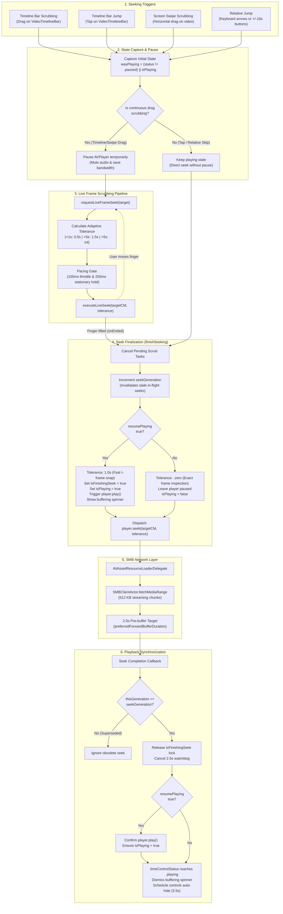

# Fichier - Features Specification

This document provides a comprehensive catalog of all features and capabilities in **Fichier**, detailing network connectivity, browsing, photo viewing, advanced video streaming, audio/subtitles playback, and system integrations.

---

## 📑 Table of Contents
1. [Network Discovery & Connection Management](#1-network-discovery--connection-management)
2. [Media Browsing & Gallery Explorer](#2-media-browsing--gallery-explorer)
3. [Photo Viewer & Slideshow Engine](#3-photo-viewer--slideshow-engine)
4. [Video Player & Streaming Engine](#4-video-player--streaming-engine)
5. [PDF & Document Viewer Engine](#5-pdf--document-viewer-engine)
6. [Playback Options: Audio, Subtitles & Speed](#6-playback-options-audio-subtitles--speed)
7. [System & External Display Integrations](#7-system--external-display-integrations)
8. [Storage, Caching & Performance](#8-storage-caching--performance)
9. [Swift 6 & Concurrency Architecture](#9-swift-6--concurrency-architecture)

---

## 1. Network Discovery & Connection Management

- **Bonjour / mDNS Zero-Config Discovery**:
  - Automatically probes the local area network for Samba and SMB servers (`_smb._tcp`) via Apple's `Network` framework (`NWBrowser`).
  - Discovered hosts are displayed in real time with hostnames and network addresses.
- **Manual Host Connection**:
  - Direct connection to network storage by entering hostname / IP address, port, share name, and credentials.
  - Supports guest/anonymous access as well as authenticated access.
- **Secure Keychain Storage (`SMBKeychain`)**:
  - Credentials (usernames and passwords) are securely stored in the iOS Keychain Services API.
  - Credentials persist securely across device restarts without plain-text exposure.
- **Multiple Server & Share Mounting**:
  - Seamlessly switch between different mounted SMB shares and storage partitions on the fly.
  - Remembers recent connections for instant one-tap reconnect.
- **Local Photo Library Mode (`PhotoLibraryActor`)**:
  - Seamless toggle between remote SMB shares and the device's local Apple Photos library (`PHPhotoLibrary`).

---

## 2. Media Browsing & Gallery Explorer

- **Hierarchical Sidebar Tree Navigation**:
  - Recursive folder directory tree (`SidebarFolderTreeView` and `FolderTreeNodeView`) for deep directory structures.
  - Collapsible/expandable nodes showing directory hierarchy and nested file counts.
- **Dual Presentation Modes (`ViewMode`)**:
  - **Grid View**: Multi-column visual gallery optimized for quick thumbnail scanning.
  - **List View**: Detailed row-based layout displaying filename, file size, modified date, and media format.
- **Pinch-to-Resize Grid Density (`GridSize`)**:
  - Interactive pinch gestures seamlessly transition between **Small**, **Medium**, and **Large** tile densities.
- **Sorting & Filtering Engine**:
  - **Filters**: *All Media*, *Photos Only*, *Videos Only*, *Documents Only*, or *Favorites*.
  - **Sorting**: Order files by *Name*, *Date Modified*, or *File Size* in *Ascending* or *Descending* order.
- **Visual Badges & Type Indicators**:
  - Distinctive badges on gallery cells: Video duration and circular watch-progress rings, **GIF** tags for animated media, and bright red **PDF** badges for documents.
- **Multi-Selection & Batch Operations (`MediaSelectionBottomBar`)**:
  - Tap "Select" to enter multi-select mode.
  - Batch export to Apple Photos or share via system share sheet.
- **Scroll Performance & Cancellation**:
  - **0ms Immediate Scrolling**: In-memory `NSCache` provides instant thumbnail rendering on ProMotion (120Hz) displays.
  - **150ms Scroll Debounce**: Avoids unnecessary server requests during rapid scrolling.
  - **Active Scroll Cancellation**: Disappearing grid cells cancel in-flight SMB thumbnail decode tasks immediately, preserving network bandwidth.

---

## 3. Photo Viewer & Slideshow Engine

- **High-Fidelity Zoom & Pan (`ZoomableImageView`)**:
  - `UIScrollView`-backed rendering engine supporting pinch-to-zoom, pan, and double-tap zoom to 1:1 pixel rendering.
  - Smooth deceleration and physics-based inertia.
- **Fluid Paging & Background Prefetching**:
  - Horizontal swipe pagination between images in the current album.
  - Asynchronous background prefetching caches preceding and succeeding images to eliminate loading lag.
- **Automated Slideshow Mode**:
  - Hands-free slideshow playback with customizable transition intervals (**2s, 3s, 5s, 10s, 15s, 30s**).
  - Configurable visual transition styles: *Slide*, *Dissolve*, and *Ken Burns* motion.
- **On-Demand EXIF Inspector (`PictureInfoSheet`)**:
  - Extracts camera metadata on the fly via `ImageIO` without downloading the full image file:
    - Camera Make & Model
    - Lens Model & Focal Length
    - Exposure Time (Shutter Speed) & Aperture (f-number)
    - ISO Sensitivity
    - Image Dimensions & File Size
    - Date and Time of Capture
- **Animated Media Decoding**:
  - Full playback support for animated **GIF** and animated **WebP** formats via frame-by-frame `ImageIO` decoding.
- **Export & Sharing**:
  - Export pictures directly to iOS Camera Roll with permission management.
  - Share via native `UIActivityViewController` / `ShareLink`.

---

## 4. Video Player & Streaming Engine

- **Progressive Byte-Range SMB Streaming**:
  - Custom `AVAssetResourceLoaderDelegate` (`SMBResourceLoaderDelegate`) intercepts AVFoundation streaming queries and fetches raw byte ranges directly from the SMB server over TCP port 445.
  - Instant playback startup for large files (including 50GB+ 4K HDR videos) without downloading the complete file.
- **Instant Local File Playback**:
  - Detects if a video is already stored in local cache and plays directly from file storage with 0ms buffering.
- **Full-Screen Swipe Gesture Seeking**:
  - Direct horizontal swipe anywhere on the video screen to scrub forward or backward.
  - **Adaptive Duration Sensitivity**: Automatically scales seeking sensitivity based on video length (> 1 hour = 2.0×, > 10 min = 1.0×, shorter = 0.5×).
- **Stationary Exact-Frame Preview**:
  - Pausing finger movement without releasing touch initiates a zero-tolerance seek (`toleranceBefore: .zero, toleranceAfter: .zero`), rendering the exact target frame on screen for precise scrubbing inspection.
- **Interactive Timeline Bar (`VideoTimelineBar`)**:
  - Draggable scrubber knob with live elapsed time indicator.
  - Tap the duration label to toggle between total video duration and remaining time countdown (`-MM:SS`).
- **Video Seeking & Scrubbing Workflow**:
  - Comprehensive 6-stage lifecycle managing touch input, live preview, SMB range requests, generational seek invalidation, and playback resumption without state corruption:

- **Continuous Playlist Navigation**:
  - Automatically advances to the next video in the folder upon playback completion.
  - **Smart EOF Rewind**: If a restored video reaches the end within 2 seconds of opening, it automatically rewinds to 0:00 rather than skipping ahead.
- **Persistent Playback History & Resume (`VideoPlaybackStore`)**:
  - Automatically saves the user's playback position to disk.
  - Automatically prompts to resume playback if position > 3 seconds.
  - Displays a floating toast banner showing *"Resumed at MM:SS"* with a one-tap **Restart** button to return to the beginning.
  - Automatically marks videos as finished once watched past 90% or within the final 4 seconds.
- **Two-Finger Tap**:
  - Double-finger tap anywhere on the video player triggers immediate play/pause with tactile haptic feedback (`UIImpactFeedbackGenerator`).
- **Smart Auto-Hide Controls**:
  - Custom controls automatically fade out after 3.5 seconds of inactivity.
  - Auto-hide timer is intelligently suppressed while scrubbing, buffering, or paused.
- **Error Recovery & Stall Detection**:
  - Automatic detection of network drops or decode errors (`AVPlayerItem.failedToPlayToEndTimeNotification`) with an error message and a dedicated **Retry** button.

---

## 5. PDF & Document Viewer Engine

- **Dual Presentation Modes**:
  - **Single Page Continuous Scroll Mode (`PDFKitRepresentedView`)**:
    - Hardware-accelerated vector document rendering via Apple's `PDFKit` (`PDFView`).
    - Seamless continuous vertical page flow (`.singlePageContinuous`, `.vertical`) with auto-scaling to device width (`autoScales = true`).
    - Native gesture support for pinch-to-zoom and multi-level zoom without vector quality degradation.
  - **Two-Page Book View Mode (`PDFSpreadPageView`, `PDFSpread`)**:
    - Dual-page spread display rendered side-by-side using high-precision vector canvas views (`PDFPageCanvasView`, `PDFPageCanvasRepresentable`).
    - Interactive 1:1 finger swipe carousel (`TabView` with `.page(indexDisplayMode: .never)`), matching the fluid feel of `PictureDetailView`.
    - Spread builder algorithm (`PDFSpread.buildSpreads`) pairing pages into spreads with an optional **First Page as Cover** toggle (`displaysAsBook`).
    - Multi-page dynamic spread indicator: displays `Pages X–Y of Z` (or `Page 1 of Z` for cover) in a glassmorphic bottom pill.
- **Leading-Edge Thumbnail Navigation (`PDFLeadingThumbnailSidebarView`, `PDFThumbnailItemCell`)**:
  - Vertically scrolling glassmorphic sidebar floating along the leading (left) edge.
  - Asynchronously renders crisp thumbnails for each page via `PDFPage.thumbnail(of:for:)`.
  - Automatically synchronizes scroll position to center the active page thumbnail as the user swipes or scrolls (`ScrollViewReader`).
  - Active page or spread is visually highlighted with a vibrant blue outline and rounded indicator ring.
  - Direct tap-to-navigate with tactile haptic feedback (`UISelectionFeedbackGenerator`).
- **Persistent Reading Mode & Preferences**:
  - Reading mode selection (`isBookMode`) and cover page preference (`displaysAsBook`) automatically persist across app launches and document changes via `@AppStorage` (`pdf_is_book_mode`, `pdf_displays_as_book`).
  - Dedicated **PDF Reader** section in global app settings (`AppSettingsView`) allowing users to configure default presentation mode and cover layout.
- **Dynamic Glassmorphic HUD & Controls (`PDFDetailView`)**:
  - **Top Bar**: Semi-transparent dark gradient bar displaying filename, file size, live page/spread indicator, reading mode quick-toggle menu, favorite bookmarking toggle, and close button.
  - **Centered Bottom Pill**: Minimalist glassmorphic capsule displaying live page status (`Page X of Y` or `Pages X–Y of Z`).
  - **Single-Tap HUD Toggle**: Tapping anywhere on the document canvas smoothly toggles all controls and sidebars with animation (`easeInOut(duration: 0.2)`).
- **Full Keyboard Navigation**:
  - `b`: Toggle between Single Page and Book View modes.
  - `←` / `→`: Navigate to previous / next page or spread.
  - `Esc`: Dismiss the viewer.
- **Native Document Export & Sharing**:
  - Direct integration with native `ShareLink` allowing one-tap AirDrop, Mail, or Files export of cached PDF files.
- **On-Demand Progressive SMB Caching**:
  - Remote documents download atomically to a dedicated local directory (`SMBDocuments`) using temporary file staging (`.part`) to avoid corrupt cache states.
  - Centered visual progress ring displaying live percentage completion and downloaded byte count.
  - Once cached, future opens load instantly with zero network roundtrips.
- **Master First-Page Thumbnail Generation**:
  - Generates high-fidelity 420px first-page previews upon first discovery, cached in `MediaCacheManager` for 0ms gallery grid rendering.

---

## 6. Playback Options: Audio, Subtitles & Speed

- **In-App Volume Control (`VideoVolumeBar`)**:
  - Custom draggable volume slider with live level feedback.
  - One-tap mute/unmute button featuring dynamic speaker wave glyphs (muted, low, medium, high).
- **Multi-Track Audio Selection**:
  - Lists and switches between alternate embedded audio streams and language tracks via the settings menu.
- **Embedded Subtitles Support (`VideoTrackManager`)**:
  - Discovers all embedded legible text subtitle streams with an "Off" toggle.
  - Live subtitle text extraction rendering high-contrast, shadowed subtitle overlays directly above player controls.
- **Variable Playback Speed**:
  - Selectable playback rates: **0.5×**, **0.75×**, **1.0×**, **1.25×**, **1.5×**, and **2.0×**.
  - Selected playback rate automatically persists when advancing to subsequent playlist videos.

---

## 7. System & External Display Integrations

- **Picture-in-Picture (PiP)**:
  - Native PiP powered by `AVPictureInPictureController`.
  - Floating PiP window allows continuous video playback while navigating elsewhere or using other iOS apps.
  - Player teardown is safely bypassed when PiP is active.
- **AirPlay Streaming (`AirPlayButtonView`)**:
  - Integrated native `AVRoutePickerView` for wireless video and audio casting to Apple TV and AirPlay 2-compatible receivers.
  - Save remote SMB videos directly into the iOS Camera Roll with real-time progress indicators and confirmation toasts.
- **Native Share Sheet**:
  - Share cached videos and media files using Apple's standard system share sheet.
- **Favorites Integration**:
  - Persistent favorite bookmarking synchronized with `FavoritesManager`.

---

## 8. Storage, Caching & Performance

- **Two-Tier Cache Architecture**:
  - **Thread-Safe Memory Cache (`ThreadSafeMemoryCache`)**: Fast LRU in-memory RAM cache with `@unchecked Sendable` isolation over `NSCache` for immediate scrolling and instantaneous UI updates.
  - **Standardized Master Disk Cache (`MediaCacheManager`)**: Persistent disk cache standardizing on a single 420px master thumbnail dimension (`standardThumbnailDimension`) to eliminate redundant re-encodings across grid sizes, with background FIFO eviction and one-tap manual cache clearing.
- **Actor-Isolated SMB Concurrency (`SMBClientActor`)**:
  - Encapsulates C-based SMB protocol engine (`libsmb2`) within a dedicated Swift Actor to guarantee absolute thread safety without deadlocks or race conditions.
- **Concurrency Throttling (`VideoThumbnailLimiter`)**:
  - Prevents network saturation by strictly limiting concurrent video thumbnail generation requests to 2, ensuring the SMB socket remains responsive for active playback.

---

## 9. Swift 6 & Concurrency Architecture

- **100% Modern Swift Concurrency**:
  - Built strictly using `actor`, `async/await`, `Task`, `@MainActor`, and `Sendable`.
  - Zero legacy synchronization primitives (no `NSLock`, `pthread_mutex`, `os_unfair_lock`, `DispatchSemaphore`, or GCD queues).
- **Strict Single Definition Rule**:
  - Every Swift `struct`, `class`, `actor`, and `enum` resides in its own dedicated source file (exactly 69 modular files).
