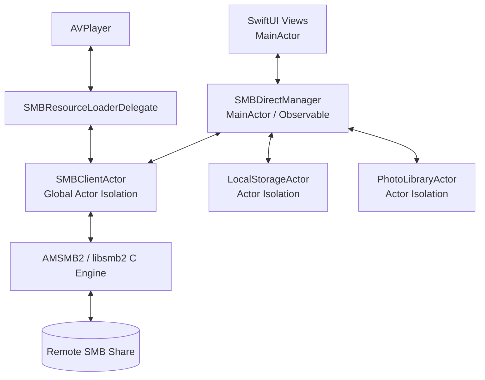

# fichier

**fichier** is a high-performance native iOS & iPadOS application designed for seamless browsing, previewing, and streaming of photos and videos hosted on network storage (Samba / SMB shares, NAS, Mac, Windows, Linux), local sandboxed folders, iCloud Drive, and the Apple Photos Library.

Built with modern **SwiftUI** and structured around **Pure Swift Concurrency**, *fichier* allows direct on-the-fly streaming of large media files (including 50GB+ 4K videos) without requiring full downloads or third-party cloud servers.

---

## 🌟 Key Features

### 📡 Network, Storage & Discovery
- **Unified Location Hub**: Seamlessly browse remote **SMB2/SMB3 shares**, local device folders, **iCloud Drive folders**, and the **Apple Photos Library** from a single unified sidebar (`LocationsSidebarView`).
- **Bonjour / mDNS Discovery**: Automatically scans the local network for SMB servers (`_smb._tcp`) via Apple's `Network` framework (`SMBHostDiscovery`).
- **Secure Keychain Storage**: Server hostnames, usernames, and passwords are saved securely in the iOS Keychain (`SMBKeychain`).
- **Multiple Share / Drive Mounts**: Switch between available shares on connected servers on the fly with clean lifecycle teardown.

### 📁 Browsing & Organization
- **Hierarchical Sidebar Tree**: Recursive folder tree navigation (`SidebarFolderTreeView`, `FolderTreeContentView`, and `FolderTreeNodeView`) for deep directory structures.
- **Adaptive Gallery Views**: Toggle between customizable multi-density **Grid** and detailed **List** view (`ViewMode`, `GridSize`).
- **Pinch-to-Resize Grid**: Fluid pinch gestures dynamically change thumbnail density between small, medium, and large layouts.
- **Filtering & Sorting**:
  - Filter by **All**, **Photos Only**, **Videos Only**, or **Favorites**.
  - Sort by **Name**, **Date Modified**, or **File Size** (ascending / descending).
  - Contextual photo and video paging preserves the user's active filter and sort order.
- **29 Supported Media Formats**: Full support for standard formats (JPEG, PNG, HEIC, GIF, WebP, MP4, MOV, MKV, AVI) and professional Camera RAW formats (DNG, CR2, NEF, ARW, RW2, AVIF, JP2).
- **Multi-Selection & Batch Actions**: Batch AirDrop / Share Sheet export and batch save to Apple Photos (`MediaSelectionBottomBar`).
- **Favorites**: Persisted local bookmarking for instant access to starred media (`FavoritesManager`).

### 📸 Photo Viewer & Slideshow
- **Deep Zoom & Pan**: Integrated `UIScrollView`-backed zoom (`ZoomableImageView`) providing 1:1 pixel rendering, double-tap zoom, and smooth deceleration.
- **Structured Paging & Prefetching**: Instant swipe navigation with automatic background prefetching and structured task cancellation (`PictureDetailView`).
- **Automated Slideshow**: Smooth transitions with configurable styles (**Slide**, **Dissolve**, **Ken Burns**) and intervals (**2s, 3s, 5s, 10s, 15s, 30s**).
- **EXIF Inspector**: Inspect camera metadata (Camera model, Lens, Aperture, Shutter Speed, ISO, Focal Length, Dimensions, Modified Date) extracted on-demand via `ImageIO`.
- **Camera Roll Export**: One-tap export to Apple Photos (`PhotoLibrarySaver`) with proper permission handling.

### 🎬 Video Player & Streaming Engine
- **Byte-Range On-Demand Streaming**: Custom `AVAssetResourceLoaderDelegate` (`SMBResourceLoaderDelegate`) intercepts AVPlayer byte requests and streams directly from SMB servers over TCP in fast 256KB chunks.
- **Hardened Seeking & Frame Scrubbing**:
  - Adaptive 0.2s seek tolerance for instant scrub resumption without stalling over SMB.
  - Live preview frame scrubbing with stationary exact-frame debounce.
  - Continuous reactive playback and buffer monitoring (`timeControlStatus`) with a 350ms debounce to prevent modal buffering popup flicker.
  - Fail-safe 800ms seek watchdog guaranteeing playback resumption.
- **Picture in Picture (PiP) & AirPlay**: Seamless background PiP and native AirPlay audio/video routing (`AirPlayButtonView`, `CustomVideoPlayerCoordinator`).
- **Audio & Subtitle Track Selection**: Dedicated track manager for switching audio tracks and external/embedded subtitles (`VideoTrackManager`).
- **Speed Control & Resume**: Multi-speed playback (0.5x to 2.0x) and automatic position resumption (`VideoPlaybackStore`).

### ⚡ Two-Tier Caching System
- **Memory Cache (`NSCache`)**: In-memory LRU cache for immediate UI responsiveness.
- **Bounded Disk Cache**: Persistent disk cache managed by `MediaCacheManager` with real-time size computation, background 300MB FIFO eviction, and one-tap manual cache purging.

---

## 🏗️ Architecture & Code Organization

The project adheres to two strict structural principles:
1. **One Definition (`class`, `struct`, `enum`, `actor`) = One File**: Exactly 63 independent, modular Swift files.
2. **Pure Swift Concurrency**: Built entirely on modern Swift concurrency (`actor`, `async/await`, `Task`, `@MainActor`, `Sendable`) with zero legacy locks or Grand Central Dispatch synchronization.

### Directory Structure

```
fichier/
│
├── MyApp.swift                             # Application entry point (@main)
├── Assets.xcassets/                        # Accent colors and asset catalog
├── fichier.icon/                           # Modern layered Xcode app icon
│
├── Features/                               # Vertical feature modules
│   ├── Connection/                         # Storage location management & host discovery
│   │   ├── DiscoveredHost.swift            # Discovered Bonjour host model
│   │   ├── RootSMBView.swift               # SplitView / Root host switcher
│   │   ├── SavedFolderLocation.swift       # Bookmark for local/iCloud folders
│   │   ├── SavedSMBConnection.swift        # Saved connection metadata model
│   │   ├── SMBConnectWithDiscoveryView.swift# Bonjour discovery list & credential form
│   │   ├── StorageLocation.swift           # Unified location model (SMB, Local, iCloud, Photos)
│   │   └── StorageLocationKind.swift       # Location kind enum
│   │
│   ├── Sidebar/                            # Hierarchical folder tree navigation
│   │   ├── FolderTreeContentView.swift     # Content column folder navigator
│   │   ├── FolderTreeNodeView.swift        # Recursive tree node component
│   │   ├── LocationsSidebarView.swift      # Unified locations sidebar list
│   │   └── SidebarFolderTreeView.swift     # Sidebar container
│   │
│   ├── Gallery/                            # Media browsing, grid, list & filtering
│   │   ├── GridSize.swift                  # Small, Medium, Large grid layout enum
│   │   ├── MediaActivityShareSheet.swift   # UIActivityViewController wrapper
│   │   ├── MediaFilter.swift               # All, Photos, Videos filter enum
│   │   ├── MediaGridView.swift             # Main media gallery view & toolbars
│   │   ├── MediaListRowCell.swift          # List row item with metadata
│   │   ├── MediaSelectionBottomBar.swift   # Floating multi-selection action bar
│   │   ├── MediaThumbnailCell.swift        # Grid thumbnail cell wrapper
│   │   ├── MediaThumbnailView.swift        # Reusable thumbnail loader & badges
│   │   ├── SortOption.swift                # Name, Date, Size sort enum
│   │   ├── VideoProgressRing.swift         # Circular playback progress badge
│   │   └── ViewMode.swift                  # Grid vs List enum
│   │
│   ├── PhotoViewer/                        # Fullscreen image viewer, gestures & EXIF
│   │   ├── PictureDetailView.swift         # Fullscreen pager & unified HUD
│   │   ├── PictureEXIFData.swift           # Parsed EXIF property model
│   │   ├── PictureInfoSheet.swift          # Modal EXIF sheet
│   │   ├── SlideDirection.swift            # Transition direction enum
│   │   ├── SlideshowTransitionStyle.swift  # Slide, Dissolve, Ken Burns transition enum
│   │   ├── ZoomableImageCoordinator.swift  # UIScrollViewDelegate handling double-tap & zoom
│   │   ├── ZoomableImageView.swift         # UIViewRepresentable wrapping UIScrollView
│   │   └── ZoomablePicturePageView.swift   # Single-image container with tap handlers
│   │
│   ├── Settings/                           # App preferences and storage management
│   │   └── AppSettingsView.swift           # Settings form, cache manager, about section
│   │
│   └── VideoPlayer/                        # Video player & streaming engine
│       ├── AirPlayButtonView.swift         # Native AVRoutePickerView wrapper
│       ├── CustomVideoPlayerCoordinator.swift# AVPlayerViewController / PiP coordinator
│       ├── CustomVideoPlayerView.swift     # UIViewRepresentable video canvas
│       ├── PlayerUIView.swift              # Custom AVPlayerLayer hosting view
│       ├── ResourceLoadingTaskTracker.swift# Actor-isolated task tracker for range requests
│       ├── SMBResourceLoaderDelegate.swift # Custom AVAsset byte-range streaming delegate
│       ├── VideoDetailView.swift           # Fullscreen player with gestures & HUD
│       ├── VideoPlaybackRate.swift         # Playback speed enum (0.5x – 2.0x)
│       ├── VideoSubtitleDelegate.swift     # Sendable subtitle text delegate
│       ├── VideoThumbnailLimiter.swift     # Actor-based concurrency throttle for video frames
│       ├── VideoTimelineBar.swift          # Interactive scrubber & duration bar
│       ├── VideoTrackManager.swift         # Audio & subtitle track selector
│       ├── VideoTrackOption.swift          # Audio / subtitle track model
│       └── VideoVolumeBar.swift            # Custom interactive volume control
│
└── Core/                                   # Shared services, models & actors
    ├── Logging/
    │   └── AppLog.swift                    # Centralized os.Logger categories
    │
    ├── Networking/                         # Protocol engine and credential storage
    │   ├── SMBClientActor.swift            # Thread-safe actor wrapping libsmb2 operations
    │   ├── SMBDirectManager.swift          # Observable UI state manager & prefetch coordinator
    │   ├── SMBHostDiscovery.swift          # NWBrowser Bonjour mDNS scanner
    │   └── SMBKeychain.swift               # Apple Keychain wrapper for SMB credentials
    │
    └── Storage/                            # Disk cache, favorites, metadata & models
        ├── AnimatedImageDecoder.swift      # ImageIO multi-frame GIF & WebP decoder
        ├── FavoritesManager.swift          # UserDefaults-backed favorite items store
        ├── ImageMetadataExtractor.swift    # ImageIO CGImageSource EXIF parser
        ├── LocalStorageActor.swift         # Sandboxed local & iCloud folder actor
        ├── MediaCacheManager.swift         # Persistent disk cache & file manager
        ├── MediaItem.swift                 # Immutable file/folder representation
        ├── PhotoLibraryActor.swift         # Apple Photos Library reader actor
        ├── PhotoLibrarySaver.swift         # PHPhotoLibrary export helper
        ├── PictureEXIFBox.swift            # Sendable EXIF container box
        ├── SupportedMediaTypes.swift       # Centralized 29 media format definitions
        ├── VideoPlaybackRecord.swift       # Persisted playback progress model
        ├── VideoPlaybackStatus.swift       # Playback status enum (unplayed, inProgress, finished)
        └── VideoPlaybackStore.swift        # Persistent playback position store
```

### Concurrency Architecture



---

## 📦 Dependencies & Requirements

### Platform Requirements
- **iOS 26.0+** / **iPadOS 26.0+** / **macOS (Catalyst) 26.0+** / **visionOS 26.0+**
- **Swift 6** language mode

### External Dependencies
- **[AMSMB2](https://github.com/amosavian/AMSMB2.git)** (`>= 4.0.3`):
  Swift wrapper around `libsmb2`, providing SMB2 and SMB3 client connectivity over TCP port 445. Integrated via **Swift Package Manager (SPM)**.

### Apple Native Frameworks
- `SwiftUI`: User interface, state management, animations.
- `Network`: `NWBrowser` for Bonjour zero-configuration network discovery.
- `AVFoundation` & `AVKit`: `AVPlayer`, `AVPlayerViewController`, `AVAssetResourceLoaderDelegate`, Picture in Picture.
- `ImageIO` & `UniformTypeIdentifiers`: Fast EXIF parsing, image downsampling, and RAW decoding.
- `Security`: Keychain Services API for password protection.
- `Photos`: `PHPhotoLibrary` and `PHAssetResourceManager` for Photos library access and Camera Roll export.

### Privacy & Entitlements (`fichier-Info.plist`)
- `NSLocalNetworkUsageDescription`: Explains why the app scans the local network for SMB servers.
- `NSBonjourServices`: Declares Bonjour service discovery for `_smb._tcp`.
- `NSPhotoLibraryUsageDescription` & `NSPhotoLibraryAddUsageDescription`: Allows browsing and saving pictures to the Photos library.

---

## 🛠️ Building & Running

1. Open the project in **Xcode**:
   ```bash
   open com.acme.ios.fichier/fichier.xcodeproj
   ```
2. Allow Xcode to resolve the **AMSMB2** Swift package dependency.
3. Select your target device (iPhone, iPad, or Simulator) running **iOS 26.0+**.
4. Press **⌘R** to build and run.
