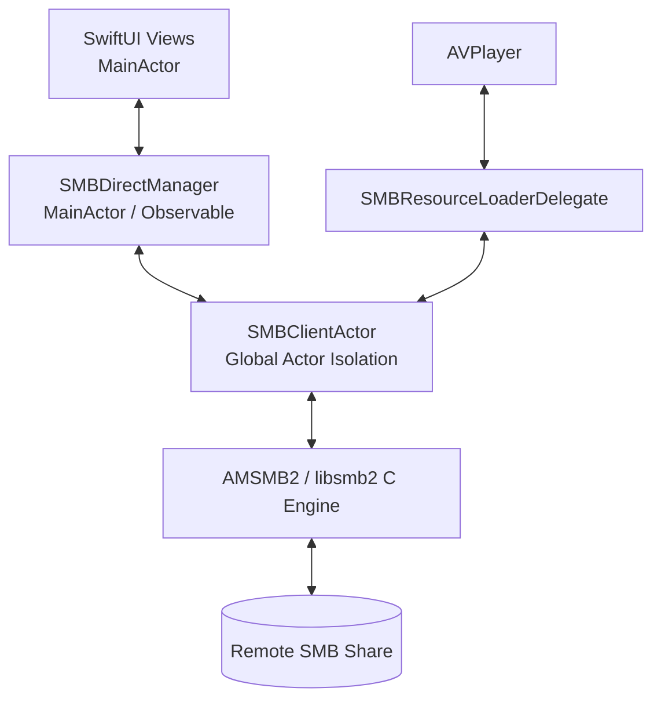

# fichier

**fichier** is a high-performance native iOS & iPadOS application designed for seamless browsing, previewing, and streaming of photos and videos hosted on network storage (Samba / SMB shares, NAS, Mac, Windows, or Linux).

Built with modern **SwiftUI** and structured around **Swift Concurrency**, *fichier* allows direct on-the-fly streaming of large media files without requiring full downloads or third-party cloud servers.

---

## 🌟 Key Features

### 📡 Network & Discovery
- **Bonjour / mDNS Discovery**: Automatically scans the local network for SMB servers (`_smb._tcp`) via Apple's `Network` framework (`NWBrowser`).
- **Secure Keychain Storage**: Server hostnames, usernames, and passwords are saved securely in the iOS Keychain (`SMBKeychain`).
- **Multiple Share / Drive Mounts**: Switch between available shares on connected servers on the fly.

### 📁 Browsing & Organization
- **Hierarchical Sidebar Tree**: Recursive folder tree navigation (`SidebarFolderTreeView` and `FolderTreeNodeView`) for deep directory structures.
- **Adaptive Gallery Views**: Toggle between customizable multi-density **Grid** and detailed **List** view (`ViewMode`, `GridSize`).
- **Pinch-to-Resize Grid**: Fluid pinch gestures dynamically change thumbnail density between small, medium, and large layouts.
- **Filtering & Sorting**:
  - Filter by **All**, **Photos Only**, **Videos Only**, or **Favorites**.
  - Sort by **Name**, **Date Modified**, or **File Size** (ascending / descending).
- **Favorites**: Persisted local bookmarking for quick access to favorite media.

### 📸 Photo Viewer & Slideshow
- **Deep Zoom & Pan**: Integrated `UIScrollView`-backed zoom (`ZoomableImageView`) providing 1:1 pixel rendering, double-tap zoom, and smooth deceleration.
- **Swipe Paging & Prefetching**: Instant swipe navigation with automatic background prefetching for zero latency.
- **Automated Slideshow**: Smooth slide transitions with user-selectable display intervals (**2s, 3s, 5s, 10s, 15s, 30s**) accessible directly from the viewer HUD and toolbar.
- **EXIF Inspector**: Inspect camera metadata (Camera model, Lens, Aperture, Shutter Speed, ISO, Focal Length, Dimensions, Modified Date) extracted on-demand via `ImageIO`.
- **Camera Roll Export**: One-tap export to Apple Photos (`PHPhotoLibrary`) with proper permission handling.

### 🎬 Video Player & Streaming Engine
- **Byte-Range Streaming**: Custom `AVAssetResourceLoaderDelegate` (`SMBResourceLoaderDelegate`) intercepts AVPlayer HTTP/custom URL requests and fetches byte ranges directly from the SMB server over TCP. Even 50GB+ 4K videos begin playing in seconds without downloading the whole file.
- **Autoplay Next Video**: When a video completes playback, the player automatically queues and plays the next video in the folder.
- **Swipe Seek Gestures**: Interactive horizontal drag gestures on the video canvas allow quick forward and backward skipping (with amplified steps for longer drags).
- **Concurrency-Limited Thumbnails**: Dedicated thumbnail queue (`VideoThumbnailLimiter`) preventing server thread saturation when scrolling through folders with dozens of video files.

### ⚡ Two-Tier Caching System
- **Memory Cache (`NSCache`)**: In-memory LRU cache for immediate UI responsiveness.
- **Disk Cache**: Persistent disk cache managed by `MediaCacheManager` with real-time size computation and one-tap manual cache purging.

---

## 🏗️ Architecture & Code Organization

The project adheres to two strict structural principles:
1. **One Definition (`class`, `struct`, `enum`, `actor`) = One File**: Exactly 33 independent, modular Swift files.
2. **Feature-Driven Architecture**: Code is decoupled into vertical domain features and shared core modules.

### Directory Structure

```
fichier/
│
├── MyApp.swift                             # Application entry point (@main)
├── Assets.xcassets/                        # App assets and accent colors
│
├── Features/                               # Vertical feature modules
│   ├── Connection/                         # SMB Host Discovery, Login & Drive Picker
│   │   ├── RootSMBView.swift               # SplitView / Root host switcher
│   │   ├── SMBConnectWithDiscoveryView.swift# Bonjour discovery list & credential form
│   │   ├── DiscoveredHost.swift            # Discovered Bonjour host model
│   │   └── SavedSMBConnection.swift        # Saved connection metadata model
│   │
│   ├── Sidebar/                            # Hierarchical folder tree navigation
│   │   ├── SidebarFolderTreeView.swift     # Sidebar container
│   │   └── FolderTreeNodeView.swift        # Recursive tree node component
│   │
│   ├── Gallery/                            # Media browsing, grid, list & filtering
│   │   ├── MediaGridView.swift             # Main media gallery view & toolbars
│   │   ├── MediaThumbnailCell.swift        # Grid thumbnail item with async loader
│   │   ├── MediaListRowCell.swift          # List row item with metadata
│   │   ├── GridSize.swift                  # Small, Medium, Large grid layout enum
│   │   ├── MediaFilter.swift               # All, Photos, Videos filter enum
│   │   ├── SortOption.swift                # Name, Date, Size sort enum
│   │   └── ViewMode.swift                  # Grid vs List enum
│   │
│   ├── PhotoViewer/                        # Fullscreen image viewer, gestures & EXIF
│   │   ├── PictureDetailView.swift         # Fullscreen pager & unified HUD
│   │   ├── ZoomablePicturePageView.swift   # Single-image container with tap handlers
│   │   ├── ZoomableImageView.swift         # UIViewRepresentable wrapping UIScrollView
│   │   ├── ZoomableImageCoordinator.swift  # UIScrollViewDelegate handling double-tap & zoom
│   │   ├── PictureInfoSheet.swift          # Modal EXIF sheet
│   │   ├── PictureEXIFData.swift           # Parsed EXIF property model
│   │   └── SlideDirection.swift            # Transition direction enum
│   │
│   └── VideoPlayer/                        # Video player & streaming delegate
│       ├── VideoDetailView.swift           # Fullscreen AVPlayer with swipe seek & autoplay
│       ├── VideoThumbnailLimiter.swift     # Task concurrency throttle for video frames
│       └── SMBResourceLoaderDelegate.swift # Custom AVAsset byte-range streaming delegate
│
└── Core/                                   # Shared services, models & actors
    ├── Networking/                         # Protocol engine and credential storage
    │   ├── SMBClientActor.swift            # Thread-safe actor wrapping libsmb2 operations
    │   ├── SMBDirectManager.swift          # Observable UI state manager & prefetch coordinator
    │   ├── SMBHostDiscovery.swift          # NWBrowser Bonjour mDNS scanner
    │   ├── SMBItem.swift                   # Immutable file/folder representation
    │   └── SMBKeychain.swift               # Apple Keychain wrapper for SMB credentials
    │
    └── Storage/                            # Disk cache, favorites & local exports
        ├── MediaCacheManager.swift         # Persistent disk cache & file manager
        ├── FavoritesManager.swift          # UserDefaults-backed favorite items store
        ├── ImageMetadataExtractor.swift    # ImageIO CGImageSource EXIF parser
        └── PhotoLibrarySaver.swift         # PHPhotoLibrary export helper
```

### Concurrency Model



- **`SMBClientActor`**: Because C-based SMB protocol engines require strict thread safety, all connection management, file enumeration, and data reads are encapsulated within an actor, preventing data races.
- **`SMBResourceLoaderDelegate`**: Runs asynchronous background tasks to fulfill `AVAssetResourceLoadingRequest` range queries without blocking the main rendering loop.

---

## 📦 Dependencies & Requirements

### External Dependencies
- **[AMSMB2](https://github.com/amosavian/AMSMB2.git)** (`>= 4.0.3`):
  Swift wrapper around `libsmb2`, providing SMB2 and SMB3 client connectivity over TCP port 445. Integrated via **Swift Package Manager (SPM)**.

### Apple Native Frameworks
- `SwiftUI`: User interface, state management, animations.
- `Network`: `NWBrowser` for Bonjour zero-configuration network discovery.
- `AVFoundation` & `AVKit`: `AVPlayer`, `AVPlayerViewController`, `AVAssetResourceLoaderDelegate`.
- `ImageIO` & `UniformTypeIdentifiers`: Fast EXIF parsing and image downsampling.
- `Security`: Keychain Services API for password protection.
- `Photos`: `PHPhotoLibrary` for saving pictures to the Camera Roll.

### Privacy & Entitlements (`fichier-Info.plist`)
The application requires the following configured keys in `fichier-Info.plist`:
- `NSLocalNetworkUsageDescription`: Explains why the app scans the local network for SMB servers.
- `NSBonjourServices`: Declares Bonjour service discovery for `_smb._tcp`.
- `NSPhotoLibraryAddUsageDescription`: Allows saving pictures to the user's Camera Roll.

---

## 🛠️ Building & Running

1. Clone or open the project folder in **Xcode 16+**:
   ```bash
   open com.acme.ios.fichier/fichier.xcodeproj
   ```
2. Allow Xcode to resolve the **AMSMB2** Swift package dependency.
3. Select your target device (iPhone, iPad, or Simulator) running **iOS 17.0+**.
4. Press **⌘R** to build and run.
