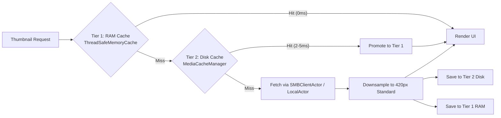
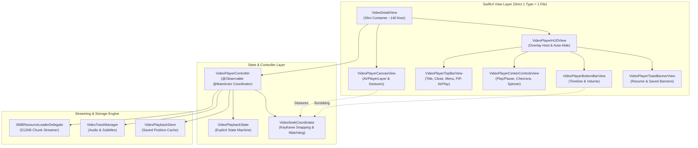
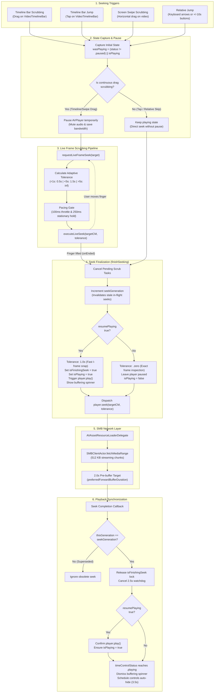
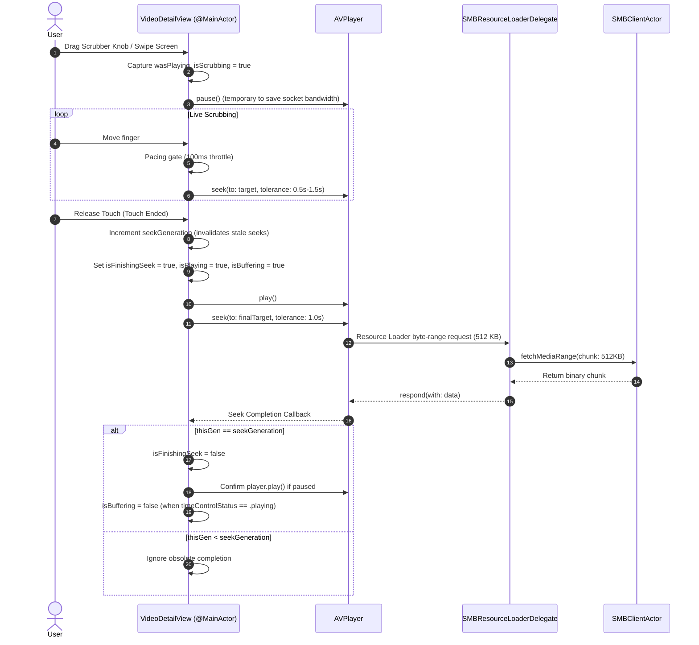

# fichier

**fichier** is a high-performance native iOS & iPadOS application designed for seamless browsing, previewing, and streaming of photos and videos hosted on network storage (Samba / SMB shares, NAS, Mac, Windows, Linux), local sandboxed folders, iCloud Drive, and the Apple Photos Library.

Built with modern **SwiftUI** and structured around **Pure Swift Concurrency**, *fichier* allows direct on-the-fly streaming of large media files (including 50GB+ 4K videos) without requiring full downloads or third-party cloud servers.

---

## 🌟 Key Features

### 📡 Network, Storage & Discovery
- **Unified Location Hub**: Seamlessly browse remote **SMB2/SMB3 shares**, local device folders, **iCloud Drive folders**, and the **Apple Photos Library** from a single unified sidebar (`LocationsSidebarView`).
- **Bonjour / mDNS Discovery**: Automatically scans the local network for SMB servers (`_smb._tcp`) via Apple's `Network` framework (`SMBHostDiscovery`).
- **Secure Keychain Storage**: Server hostnames, usernames, and passwords are saved securely in the iOS Keychain (`SMBKeychain`).
- **Multiple Share / Drive Mounts**: Switch between available shares on connected servers on the fly with clean lifecycle teardown.

### 📁 Browsing & Organization
- **Hierarchical Sidebar Tree**: Recursive folder tree navigation (`SidebarFolderTreeView`, `FolderTreeContentView`, and `FolderTreeNodeView`) for deep directory structures with automatic expansion of selected paths.
- **Parent Folder Quick Navigation**: Blue-tinted parent folder button (`arrow.up.folder`) positioned at the first slot in the gallery toolbar for one-tap navigation back to the parent directory, disabled at root level to prevent toolbar layout shifts.
- **Adaptive Gallery Views**: Toggle between customizable multi-density **Grid** and detailed **List** view (`ViewMode`, `GridSize`).
- **Pinch-to-Resize Grid**: Fluid pinch gestures dynamically change thumbnail density between small, medium, and large layouts.
- **Filtering & Sorting**:
  - Filter by **All**, **Photos Only**, **Videos Only**, **Documents Only**, or **Favorites**.
  - Sort by **Name**, **Date Modified**, or **File Size** (ascending / descending).
  - Contextual photo and video paging preserves the user's active filter and sort order.
- **32 Supported Media & Document Formats**: Broad format coverage including standard images (JPEG, PNG, HEIC, GIF, WebP, AVIF, TIFF, BMP, ICO, JP2), professional Camera RAW formats (DNG, CR2, CR3, NEF, ARW, RW2, ORF, PEF, RAF), native streaming video (MP4, MOV, M4V), and native PDF documents (PDF). Extended containers (MKV, AVI, WebM) are specified in [`feature_more_codec.md`](file:///Users/kevinlaunay/source/apple/com.acme.ios.fichier/feature_more_codec.md).
- **Multi-Selection & Batch Actions**: Batch AirDrop / Share Sheet export and batch save to Apple Photos (`MediaSelectionBottomBar`).
- **Favorites**: Persisted local bookmarking for instant access to starred media (`FavoritesManager`).

### 📄 PDF & Document Viewer
- **Dual Reading Modes**:
  - **Single Page Continuous Scroll**: Native vertical scrolling with dynamic pinch-to-zoom and double-tap zoom capabilities (`PDFKitRepresentedView`).
  - **Two-Page Book Mode**: Spread-based layout (`PDFSpreadPageView`, `PDFSpread`) with an interactive 1:1 finger swipe carousel (`TabView`), dynamic spread indicators (`Pages X–Y of Z`), and an optional **First Page as Cover** layout toggle.
- **Reading Mode Persistence**: Reading mode preferences (`isBookMode`, `displaysAsBook`) are automatically saved via `@AppStorage` and globally configurable in **App Settings** (`AppSettingsView`).
- **Leading-Edge Thumbnail Sidebar**: Vertically scrollable glassmorphic thumbnail sidebar (`PDFLeadingThumbnailSidebarView`, `PDFThumbnailItemCell`) with automatic active page/spread tracking, auto-centering scroll synchronization, and one-tap page jumps.
- **Dynamic Reading HUD & Keyboard Shortcuts**: Glassmorphic overlay with dynamic page/spread indicator (`Page X of Y` or `Pages X–Y of Z`), document title, file size, favorite bookmarking, and native Share Sheet export (`PDFDetailView`). Full keyboard navigation (`b` for book mode, `←` / `→` for page turning, `Esc` to dismiss).
- **Zero-Latency Local Caching**: On-demand atomic download from SMB servers to the dedicated document cache directory (`SMBDocuments`) with live percentage and byte progress indicator.
- **Instant Grid Preview**: High-resolution 420px first-page master thumbnail generation stored in the two-tier cache for 0ms gallery loading.

### 📸 Photo Viewer & Slideshow
- **Deep Zoom & Pan**: Integrated `UIScrollView`-backed zoom (`ZoomableImageView`) providing 1:1 pixel rendering, double-tap zoom, and smooth deceleration.
- **Structured Paging & Prefetching**: Instant swipe navigation with automatic background prefetching and structured task cancellation (`PictureDetailView`).
- **Automated Slideshow**: Smooth transitions with configurable styles (**Slide**, **Dissolve**, **Ken Burns**) and intervals (**2s, 3s, 5s, 10s, 15s, 30s**).
- **EXIF Inspector**: Inspect camera metadata (Camera model, Lens, Aperture, Shutter Speed, ISO, Focal Length, Dimensions, Modified Date) extracted on-demand via `ImageIO`.
- **Camera Roll Export**: One-tap export to Apple Photos (`PhotoLibrarySaver`) with proper permission handling.

### 🎬 Video Player & Streaming Engine (Video Player 2.0)
- **Decoupled State-Machine Architecture**: Built with `@Observable @MainActor` coordinator (`VideoPlayerController`), an explicit `Sendable` playback state machine (`VideoPlaybackState`), a hardened seek coordinator (`VideoSeekCoordinator`), and modular single-responsibility views.
- **Byte-Range On-Demand Streaming**: Custom `AVAssetResourceLoaderDelegate` (`SMBResourceLoaderDelegate`) intercepts AVPlayer byte requests and streams directly from SMB servers over TCP in fast 512KB chunks.
- **Hardened Seeking & Frame Scrubbing**:
  - Adaptive 0.5s - 1.5s seek tolerance for instant scrub resumption without stalling over SMB.
  - Live preview frame scrubbing with stationary exact-frame debounce (250ms).
  - Re-entrancy locking (`isFinishingSeek`) preventing background playback monitors from resetting playing state during network fill.
  - Generational seek tracking (`seekGeneration`) ensuring only the latest user-intended target resumes playback.
  - Pre-buffered 2.0s forward read-ahead window for smooth resumption without Wi-Fi roundtrip latency.
- **Picture in Picture (PiP) & AirPlay**: Seamless background PiP and native AirPlay audio/video routing (`AirPlayButtonView`, `CustomVideoPlayerCoordinator`).
- **Audio & Subtitle Track Selection**: Dedicated track manager for switching audio tracks and external/embedded subtitles (`VideoTrackManager`).
- **Speed Control & Resume**: Multi-speed playback (0.5x to 2.0x) and automatic position resumption (`VideoPlaybackStore`).

### ⚡ Two-Tier Caching System
- **Thread-Safe Memory Cache (`ThreadSafeMemoryCache`)**: In-memory LRU cache wrapping `NSCache` with `@unchecked Sendable` isolation for immediate UI responsiveness.
- **Bounded Disk Cache (`MediaCacheManager`)**: Persistent disk cache with a unified 420px master thumbnail dimension (`standardThumbnailDimension`) eliminating redundant re-encodings across grid sizes, real-time size computation, background 300MB FIFO eviction, and one-tap manual cache purging.



---

## 🏗️ Architecture & Code Organization

The project adheres to two strict structural principles:
1. **One Definition (`class`, `struct`, `enum`, `actor`) = One File**: Exactly 97 independent, modular Swift files (87 application files + 10 unit test suites).
2. **Pure Swift Concurrency**: Built entirely on modern Swift concurrency (`actor`, `async/await`, `Task`, `@MainActor`, `Sendable`) with zero legacy locks or Grand Central Dispatch synchronization.

### Directory Structure

```
fichier/
│
├── MyApp.swift                             # Application entry point (@main)
├── Assets.xcassets/                        # Accent colors and asset catalog
├── fichier.icon/                           # Modern layered Xcode app icon
│
├── Features/                               # Vertical feature modules
│   ├── Connection/                         # Storage location management & host discovery
│   │   ├── DiscoveredHost.swift            # Discovered Bonjour host model
│   │   ├── RootSMBView.swift               # SplitView / Root host switcher
│   │   ├── SavedFolderLocation.swift       # Bookmark for local/iCloud folders
│   │   ├── SavedSMBConnection.swift        # Saved connection metadata model
│   │   ├── SMBConnectWithDiscoveryView.swift# Bonjour discovery list & credential form
│   │   ├── StorageLocation.swift           # Unified location model (SMB, Local, iCloud, Photos)
│   │   └── StorageLocationKind.swift       # Location kind enum
│   │
│   ├── Sidebar/                            # Hierarchical folder tree navigation
│   │   ├── FolderTreeContentView.swift     # Content column folder navigator
│   │   ├── FolderTreeNodeView.swift        # Recursive tree node component
│   │   ├── LocationsSidebarView.swift      # Unified locations sidebar list
│   │   └── SidebarFolderTreeView.swift     # Sidebar container
│   │
│   ├── Gallery/                            # Media browsing, grid, list & filtering
│   │   ├── GridSize.swift                  # Small, Medium, Large grid layout enum
│   │   ├── MediaActivityShareSheet.swift   # UIActivityViewController wrapper
│   │   ├── MediaFilter.swift               # All, Photos, Videos, Documents filter enum
│   │   ├── MediaGridView.swift             # Main media gallery view & toolbars
│   │   ├── MediaListRowCell.swift          # List row item with metadata
│   │   ├── MediaSelectionBottomBar.swift   # Floating multi-selection action bar
│   │   ├── MediaThumbnailCell.swift        # Grid thumbnail cell wrapper
│   │   ├── MediaThumbnailView.swift        # Reusable thumbnail loader & badges
│   │   ├── SortOption.swift                # Name, Date, Size sort enum
│   │   ├── VideoProgressRing.swift         # Circular playback progress badge
│   │   └── ViewMode.swift                  # Grid vs List enum
│   │
│   ├── PhotoViewer/                        # Fullscreen image viewer, gestures & EXIF
│   │   ├── PictureDetailView.swift         # Fullscreen pager & unified HUD
│   │   ├── PictureEXIFData.swift           # Parsed EXIF property model
│   │   ├── PictureInfoSheet.swift          # Modal EXIF sheet
│   │   ├── PictureViewerBottomBarView.swift# Liquid glass bottom action toolbar
│   │   ├── PictureViewerTopBarView.swift   # Top bar with close button & file info capsule
│   │   ├── SlideDirection.swift            # Transition direction enum
│   │   ├── SlideshowTransitionStyle.swift  # Slide, Dissolve, Ken Burns transition enum
│   │   ├── ZoomableImageCoordinator.swift  # UIScrollViewDelegate handling double-tap & zoom
│   │   ├── ZoomableImageView.swift         # UIViewRepresentable wrapping UIScrollView
│   │   └── ZoomablePicturePageView.swift   # Single-image container with tap handlers
│   │
│   ├── PDFViewer/                          # Native PDF Document Viewing
│   │   ├── PDFDetailView.swift             # Fullscreen document viewer HUD & download progress
│   │   ├── PDFKitCoordinator.swift         # Delegate & notification coordinator for PDFView
│   │   ├── PDFKitRepresentedView.swift     # UIViewRepresentable hosting PDFView (Single Page)
│   │   ├── PDFLeadingThumbnailSidebarView.swift # Floating vertical thumbnail sidebar on leading edge
│   │   ├── PDFPageCanvasRepresentable.swift# UIViewRepresentable wrapper for vector page canvas
│   │   ├── PDFPageCanvasView.swift         # CoreGraphics vector PDF page rendering view
│   │   ├── PDFReadingMode.swift            # Reading mode enum (continuous, book, twoUp)
│   │   ├── PDFSpread.swift                 # Page spread model & builder for book layout
│   │   ├── PDFSpreadPageView.swift         # Spread page view (single or two-page spread)
│   │   ├── PDFThumbnailItemCell.swift      # Asynchronous thumbnail card with active ring
│   │   └── PDFThumbnailScrubberView.swift  # Embedded PDFThumbnailView wrapper
│   │
│   ├── Settings/                           # App preferences and storage management
│   │   └── AppSettingsView.swift           # Settings form, cache manager, about section
│   │
│   └── VideoPlayer/                        # Video player & streaming engine (Video Player 2.0)
│       ├── AirPlayButtonView.swift         # Native AVRoutePickerView wrapper
│       ├── CustomVideoPlayerCoordinator.swift# AVPlayerViewController / PiP coordinator
│       ├── CustomVideoPlayerView.swift     # UIViewRepresentable video canvas
│       ├── PlayerUIView.swift              # Custom AVPlayerLayer hosting view
│       ├── ResourceLoadingTaskTracker.swift# Actor-isolated task tracker for range requests
│       ├── SMBResourceLoaderDelegate.swift # Custom AVAsset byte-range streaming delegate
│       ├── VideoDetailView.swift           # Lightweight host container & keyboard shortcut binder
│       ├── VideoPlaybackRate.swift         # Playback speed enum (0.5x – 2.0x)
│       ├── VideoPlaybackState.swift        # Explicit Sendable playback state machine enum
│       ├── VideoPlayerBottomBarView.swift  # Unified liquid glass deck hosting title, metadata & timeline scrubber
│       ├── VideoPlayerCanvasView.swift     # Video canvas host with swipe & tap gesture recognizers
│       ├── VideoPlayerCenterControlsView.swift # Buffering spinner, retry, and center play/pause
│       ├── VideoPlayerController.swift     # Observable MainActor playback engine coordinator
│       ├── VideoPlayerHUDView.swift        # Auto-hiding HUD overlay container
│       ├── VideoPlayerToastBannerView.swift# Resume & save glassmorphic toast pills
│       ├── VideoPlayerTopBarView.swift     # Responsive top HUD toolbar (close, volume, action tools)
│       ├── VideoSeekCoordinator.swift      # Scrubbing & seeking pipeline coordinator
│       ├── VideoSubtitleDelegate.swift     # Sendable subtitle text delegate
│       ├── VideoThumbnailLimiter.swift     # Actor-based concurrency throttle for video frames
│       ├── VideoTimelineBar.swift          # Interactive scrubber & duration bar
│       ├── VideoTrackManager.swift         # Audio & subtitle track selector
│       ├── VideoTrackOption.swift          # Audio / subtitle track model
│       └── VideoVolumeBar.swift            # Custom interactive volume control
│
├── Core/                                   # Shared services, models & actors
│   ├── Logging/
│   │   └── AppLog.swift                    # Centralized os.Logger categories
│   │
│   ├── Networking/                         # Protocol engine and credential storage
│   │   ├── SMBClientActor.swift            # Thread-safe actor wrapping libsmb2 operations
│   │   ├── SMBHostDiscovery.swift          # NWBrowser Bonjour mDNS scanner
│   │   └── SMBKeychain.swift               # Apple Keychain wrapper for SMB credentials
│   │
│   └── Storage/                            # Disk cache, favorites, metadata & models
│       ├── AnimatedImageDecoder.swift      # ImageIO multi-frame GIF & WebP decoder
│       ├── FavoritesManager.swift          # UserDefaults-backed favorite items store
│       ├── ImageMetadataExtractor.swift    # ImageIO CGImageSource EXIF parser
│       ├── LocalStorageActor.swift         # Sandboxed local & iCloud folder actor
│       ├── MediaCacheManager.swift         # Persistent disk cache & file manager
│       ├── MediaItem.swift                 # Immutable file/folder representation
│       ├── PhotoLibraryActor.swift         # Apple Photos Library reader actor
│       ├── PhotoLibrarySaver.swift         # PHPhotoLibrary export helper
│       ├── PictureEXIFBox.swift            # Sendable EXIF container box
│       ├── StorageLocationManager.swift    # Unified Observable UI state manager & prefetch coordinator
│       ├── SupportedMediaTypes.swift       # Centralized 31 media format definitions
│       ├── ThreadSafeMemoryCache.swift     # Generic Sendable NSCache wrapper
│       ├── VideoPlaybackRecord.swift       # Persisted playback progress model
│       ├── VideoPlaybackStatus.swift       # Playback status enum (unplayed, inProgress, finished)
│       └── VideoPlaybackStore.swift        # Persistent playback position store
│
└── Tests/                                  # Unit test suites
    ├── MediaCacheManagerTests.swift        # Cache key, dimension, and eviction tests
    ├── MediaItemTests.swift                # Equatable, child mutation, and path component tests
    ├── PDFKitCoordinatorTests.swift        # PDF navigation, coordinator, and observer tests
    ├── PDFReadingModeTests.swift           # Reading mode cases, properties, and identifier tests
    ├── PDFSpreadTests.swift                # Spread builder and cover layout tests
    ├── PDFThumbnailSidebarTests.swift      # Thumbnail sidebar model and callback tests
    ├── StorageLocationManagerTests.swift   # Root detection, parent derivation & path hygiene tests
    ├── SupportedMediaTypesTests.swift      # File extension and format detection tests
    ├── VideoPlaybackStateTests.swift       # Playback state enum, equality, and transition tests
    └── VideoSeekCoordinatorTests.swift     # Seek generation, tolerance, and scrub lifecycle tests
```

### Concurrency Architecture

```mermaid
flowchart TD
    subgraph MainActorContext["@MainActor UI & State Layer"]
        V[SwiftUI Views<br/>VideoDetailView, MediaGridView, etc.]
        M[StorageLocationManager<br/>@Observable UI Coordinator]
        S[VideoPlaybackStore<br/>@Observable Playback Store]
        F[FavoritesManager<br/>@Observable Favorites Store]
    end

    subgraph ActorBoundaries["Actor-Isolated Workers"]
        A_SMB[SMBClientActor<br/>libsmb2 C engine wrapper]
        A_LOC[LocalStorageActor<br/>Security-scoped bookmark worker]
        A_PH[PhotoLibraryActor<br/>PHPhotoLibrary worker]
        A_LIM[VideoThumbnailLimiter<br/>Concurrency throttle (Max: 2)]
        A_TRK[ResourceLoadingTaskTracker<br/>Streaming task registry]
    end

    subgraph NativeFrameworks["OS & Protocol Layer"]
        C_LIB[libsmb2 / TCP 445]
        C_AV[AVPlayer / AVAssetResourceLoader]
        C_FS[Local Filesystem / iCloud Drive]
        C_PH[PhotoKit API]
    end

    V <--> M
    M <--> S
    M <--> F

    M <--> A_SMB
    M <--> A_LOC
    M <--> A_PH
    M <--> A_LIM
    C_AV <--> A_TRK

    A_SMB <--> C_LIB
    A_LOC <--> C_FS
    A_PH <--> C_PH
```

### Video Player 2.0 Architecture



### Video Seeking & Scrubbing Workflow



#### Seek & Scrub Resumption Sequence



---

## 📦 Dependencies & Requirements

### Platform Requirements
- **iOS 26.0+** / **iPadOS 26.0+** / **macOS (Catalyst) 26.0+** / **visionOS 26.0+**
- **Swift 6** language mode

### External Dependencies
- **[AMSMB2](https://github.com/amosavian/AMSMB2.git)** (`>= 4.0.3`):
  Swift wrapper around `libsmb2`, providing SMB2 and SMB3 client connectivity over TCP port 445. Integrated via **Swift Package Manager (SPM)**.

### Apple Native Frameworks
- `SwiftUI`: User interface, state management, animations.
- `PDFKit`: `PDFView` and `PDFThumbnailView` for hardware-accelerated document reading and page scrubbing.
- `Network`: `NWBrowser` for Bonjour zero-configuration network discovery.
- `AVFoundation` & `AVKit`: `AVPlayer`, `AVPlayerViewController`, `AVAssetResourceLoaderDelegate`, Picture in Picture.
- `ImageIO` & `UniformTypeIdentifiers`: Fast EXIF parsing, image downsampling, and RAW decoding.
- `Security`: Keychain Services API for password protection.
- `Photos`: `PHPhotoLibrary` and `PHAssetResourceManager` for Photos library access and Camera Roll export.

### Privacy & Entitlements (`fichier-Info.plist`)
- `NSLocalNetworkUsageDescription`: Explains why the app scans the local network for SMB servers.
- `NSBonjourServices`: Declares Bonjour service discovery for `_smb._tcp`.
- `NSPhotoLibraryUsageDescription` & `NSPhotoLibraryAddUsageDescription`: Allows browsing and saving pictures to the Photos library.

---

## 🛠️ Building & Running

1. Open the project in **Xcode**:
   ```bash
   open com.acme.ios.fichier/fichier.xcodeproj
   ```
2. Allow Xcode to resolve the **AMSMB2** Swift package dependency.
3. Select your target device (iPhone, iPad, or Simulator) running **iOS 26.0+**.
4. Press **⌘R** to build and run.
