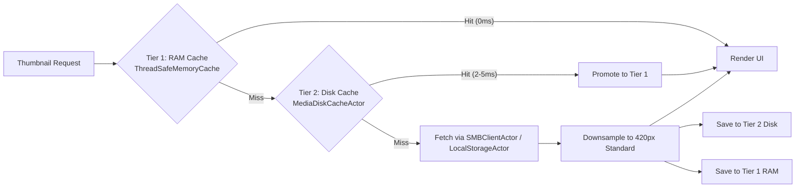
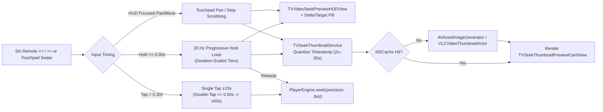
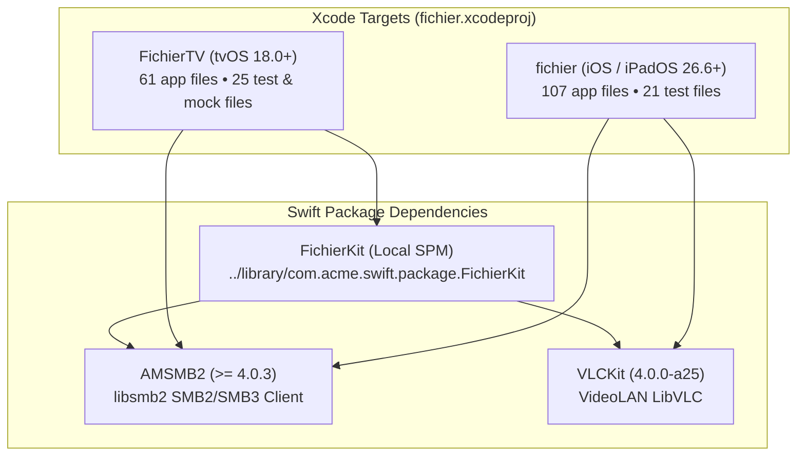
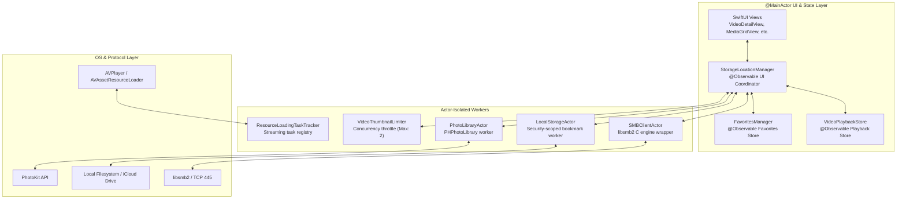
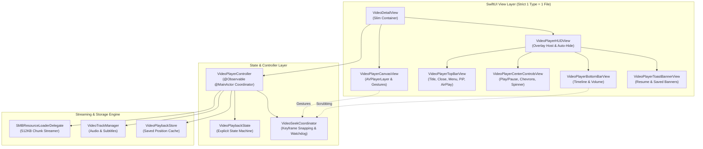
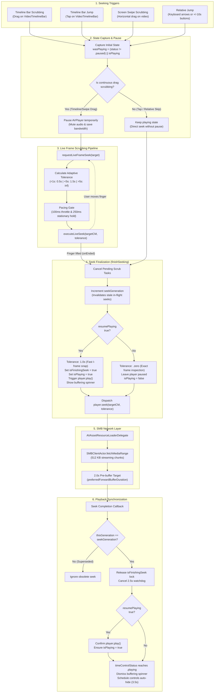
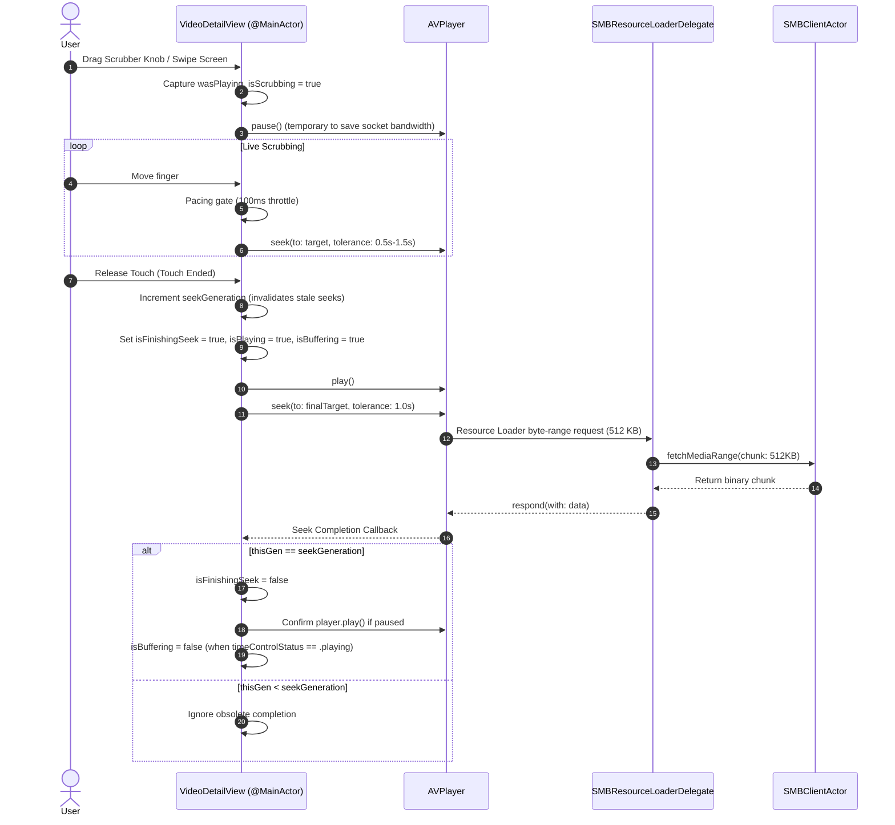

# fichier

**fichier** is a native **iOS**, **iPadOS**, and **Apple TV (tvOS)** application designed for seamless browsing, previewing, and streaming of photos, videos, and documents hosted on network storage (Samba / SMB shares, NAS, Mac, Windows, Linux), local sandboxed folders, iCloud Drive, and the Apple Photos Library.

Built with modern **SwiftUI** and structured around **Pure Swift Concurrency**, *fichier* pairs the iOS/iPadOS app (`fichier`) with a dedicated Apple TV experience (`FichierTV`) powered by the shared **`FichierKit`** Swift 6 package—enabling direct on-the-fly streaming of large media files (including 50GB+ 4K videos) without staging full downloads on device storage.

---

## 🌟 Key Features

### 📡 Network, Storage & Discovery
- **Unified Location Hub**: Seamlessly browse remote **SMB2/SMB3 shares**, local device folders, **iCloud Drive folders**, and the **Apple Photos Library** from a single unified sidebar (`LocationsSidebarView`) on iOS/iPadOS or top navigation sections (`TVRootMediaBrowserView`) on tvOS.
- **Bonjour / mDNS Discovery**: Automatically scans the local network for SMB servers (`_smb._tcp`) via Apple's `Network` framework (`SMBHostDiscovery`).
- **Secure Keychain Storage**: Server hostnames, usernames, and passwords are stored securely in the Keychain (`SMBKeychain` on iOS/iPadOS, `SMBPasswordStore` in `FichierKit` on tvOS).
- **Multiple Share & Pre-Save Validation**: Switch between available shares on connected servers with clean lifecycle teardown, and validate credentials and accessible shares before persisting connections.

### 📁 Browsing & Organization
- **Hierarchical Sidebar Tree**: Recursive folder tree navigation (`SidebarFolderTreeView`, `FolderTreeContentView`, `FolderTreeNodeView`) for deep directory structures with automatic expansion of selected paths (`FolderNavigationCoordinator`).
- **Parent Folder Quick Navigation**: Blue-tinted parent folder button (`arrow.up.folder`) in the gallery toolbar for one-tap navigation back to the parent directory, disabled at root level to prevent toolbar layout shifts.
- **Adaptive Gallery Views**: Toggle between customizable multi-density **Grid** (`MediaGridModeView`) and detailed **List** views (`MediaListModeView`), with clean loading/error/empty states (`MediaGridEmptyStateView`).
- **Pinch-to-Resize Grid**: Fluid pinch gestures dynamically change thumbnail density between small, medium, and large layouts (`ViewMode`, `GridSize`).
- **Filtering & Sorting**:
  - Filter by **All**, **Photos Only**, **Videos Only**, or **Documents Only**, plus a **Favorites** toggle.
  - Sort by **Name**, **Date Modified**, or **File Size** (ascending / descending); contextual photo and video paging preserves active filter and sort state.
- **53 Supported Media & Document Formats (`SupportedMediaTypes`)**:
  - **28 Image Formats**: Standard, animated, and high-efficiency formats (`JPEG`, `PNG`, `HEIC`, `HEIF`, `GIF`, `WebP`, `AVIF`, `TIFF`, `BMP`, `ICO`, `JP2`) plus Camera RAW (`CR2`, `CR3`, `NEF`, `ARW`, `DNG`, `ORF`, `RW2`, `PEF`, `RAF`).
  - **4 Native Video Formats**: `MP4`, `MOV`, `M4V`, `3GP`.
  - **20 Extended Video Formats**: `MKV`, `AVI`, `WebM`, `FLV`, `F4V`, `WMV`, `ASF`, `TS`, `M2TS`, `MTS`, `M2V`, `MPG`, `MPEG`, `VOB`, `OGV`, `RM`, `MXF`, `WTV`, `HEVC`, `MJPEG`.
  - **1 Document Format (iOS / iPadOS)**: Native `PDF` rendering and inspection.
- **Multi-Selection & Batch Actions**: Batch AirDrop / Share Sheet export and batch save to Apple Photos (`MediaSelectionBottomBar`).
- **Favorites**: Persisted local bookmarking for instant access to starred media (`FavoritesManager`).

### 🌐 Comprehensive Localization & Multi-Target Catalog Architecture
- **Unified 308-Key String Catalog (`strings.xcstrings`)**: Comprehensive localization covering iOS, iPadOS, and tvOS across **11 languages** (`English`, `French`, `German`, `Spanish`, `Italian`, `Japanese`, `Dutch`, `Polish`, `Portuguese (Portugal)`, `Simplified Chinese`, and `Traditional Chinese`).
- **Direct Multi-Target Project Membership**: Native Xcode project target membership for `fichier/strings.xcstrings` across both the primary `fichier` target and `FichierTV` (via `PBXResourcesBuildPhase`), avoiding filesystem symlinks and guaranteeing deterministic, parallel-safe `xcstringtool` compilation across all CI/CD environments.
- **Type-Safe `.Strings.*` Generation**: Automatic compiler-generated `LocalizedStringResource` extensions for type-safe compile-time validation, positional parameter parity (`%@`, `%lld`, `%1$lld of %2$lld`), and zero hardcoded user-facing strings across:
  - Sidebar and folder navigation (`gallery_navigate_parent_folder`, `gallery_parent_folder`, `sidebar_action_remove_location`).
  - Security-scoped bookmark and local filesystem errors (`storage_error_locate_folder`, `storage_error_permission_expired`, etc.).
  - PDF reader options and reading modes (`pdf_reading_mode_single_page`, `pdf_reading_mode_book_view`, etc.).
  - Video player HUD controls, timeline scrubbing hints, and AirPlay/VLC routing options.
  - Apple TV (tvOS) grid/list toggles, slideshow sheets, audio/subtitle tracks, and Bonjour SMB discovery flows.
- **Clean Package Domain Boundary**: FichierKit models, engines, and errors are localized directly within `FichierKit`'s package bundle (`Localizable.xcstrings`), keeping the application catalog focused on host and platform presentation.

### 📄 PDF & Document Viewer (iOS & iPadOS)
- **Dual Reading Modes**:
  - **Single Page Continuous Scroll**: Native vertical scrolling with dynamic pinch-to-zoom and double-tap zoom capabilities (`PDFKitRepresentedView`).
  - **Two-Page Book Mode**: Spread-based layout (`PDFSpreadPageView`, `PDFSpread`) with an interactive 1:1 finger swipe carousel (`TabView`), dynamic spread indicators (`Pages X–Y of Z`), and an optional **First Page as Cover** layout toggle.
- **Reading Mode Persistence**: Reading mode preferences (`isBookMode`, `displaysAsBook`) automatically save via `@AppStorage` and can be configured in **App Settings** (`AppSettingsView`).
- **Leading-Edge Thumbnail Sidebar**: Vertically scrollable glassmorphic thumbnail sidebar (`PDFLeadingThumbnailSidebarView`, `PDFThumbnailItemCell`) with active page/spread tracking, auto-centering scroll synchronization, throttled SMB extraction (`PDFThumbnailLimiter`), and one-tap page jumps.
- **Dynamic Reading HUD & Keyboard Shortcuts**: Glassmorphic overlay with live page/spread indicator, document title, file size, favorite bookmarking, Share Sheet export (`PDFDetailView`), and keyboard navigation (`b` for book mode, `←` / `→` for page turning, `Esc` to dismiss).
- **Zero-Latency Local Caching**: Atomic downloads from SMB servers to the document cache directory (`SMBDocuments`) with live byte progress and 420px first-page grid thumbnails.

### 📸 Photo Viewer & Slideshow
- **Deep Zoom & Pan**: Integrated `UIScrollView`-backed zoom (`ZoomableImageView`) providing 1:1 pixel rendering, double-tap zoom, and smooth deceleration.
- **Structured Paging & Prefetching**: Instant swipe navigation with automatic background prefetching and structured task cancellation (`PictureDetailView`).
- **Automated Slideshow**: Smooth transitions with configurable styles (**Slide**, **Dissolve**, **Ken Burns**) and intervals (**2s, 3s, 5s, 10s, 15s, 30s**).
- **EXIF Inspector**: Inspect camera metadata (Camera model, Lens, Aperture, Shutter Speed, ISO, Focal Length, Dimensions, Modified Date) extracted on-demand via `ImageIO`.
- **Camera Roll Export**: One-tap export to Apple Photos (`PhotoLibrarySaver`) with proper permission handling.

### 🎬 Video Player & Streaming Engine (Video Player 2.0)
- **Hybrid Dual-Engine Architecture (`VideoPlayerEngineProtocol`)**: Intelligently routes media based on container and codec while maintaining unified controls and gestures:
  - **Native Engine (`NativePlayerEngine`)**: Hardware-accelerated Apple `AVPlayer` with `SMBResourceLoaderDelegate` for `.mp4`, `.mov`, `.m4v`, and `.3gp`.
  - **Extended Engine (`ExtendedPlayerEngine`)**: VideoLAN `VLCKit` (`4.x`) engine decoding open containers (`.mkv`, `.avi`, `.webm`, `.flv`, `.wmv`, `.ts`, `.ogv`, `.rm`, etc.) and non-Apple audio/subtitles (Vorbis, AC-3, DTS, TrueHD, ASS/SSA).
- **Pure Swift 6 HTTP Loopback Streaming (`SMBStreamingServerActor`)**: Uses Apple's `Network` framework (`NWListener`) on `127.0.0.1` to stream remote SMB byte ranges directly into LibVLC on demand without staging temporary files on disk.
- **Decoupled State-Machine Architecture**: Built with `@Observable @MainActor` coordinator (`VideoPlayerController`), an explicit `Sendable` playback state machine (`VideoPlaybackState`), a hardened seek coordinator (`VideoSeekCoordinator`), typed stream errors (`SMBStreamError`), and modular single-responsibility views.
- **Byte-Range On-Demand Streaming**: Custom `AVAssetResourceLoaderDelegate` (`SMBResourceLoaderDelegate`) intercepts AVPlayer byte requests and streams directly from SMB servers over TCP in fast 512KB chunks.
- **Hardened Seeking & Frame Scrubbing**:
  - Adaptive 0.5s – 1.5s seek tolerance for instant scrub resumption without stalling over SMB.
  - Live preview frame scrubbing with stationary exact-frame debounce (250ms).
  - Re-entrancy locking (`isFinishingSeek`), generational seek tracking (`seekGeneration`), and a 2.0s forward read-ahead buffer.
- **Picture in Picture (PiP) & AirPlay**: Background PiP and native AirPlay routing (`AirPlayButtonView`, `CustomVideoPlayerCoordinator`).
- **Audio, Subtitles, Speed & Resume**: Track switching (`VideoTrackManager`), multi-speed playback (`0.5x` – `2.0x`), and persisted resume timestamps (`VideoPlaybackStore`).

### ⚡ Two-Tier Caching System
- **Thread-Safe Memory Cache (`ThreadSafeMemoryCache`)**: In-memory LRU cache wrapping `NSCache` with `@unchecked Sendable` isolation for immediate UI responsiveness.
- **Actor-Isolated Disk Cache (`MediaCacheManager`, `MediaDiskCacheActor`)**: Persistent disk cache standardizing on a 420px master thumbnail dimension (`standardThumbnailDimension`), eliminating redundant re-encodings across grid sizes with real-time size reporting, background 300MB FIFO eviction, and one-tap cache purging.
- **Extended Video Thumbnailing (`VLCMediaThumbnailerActor`, `VLCMediaThumbnailerSession`)**: Serialized `VLCKit` (`VLCMediaThumbnailer`) keyframe extraction over loopback HTTP (`SMBStreamingServerActor`) with watchdog timeouts and concurrency throttling (`VideoThumbnailLimiter`).
- **Non-Blocking Thumbnail Failure & Playback Fallback (`MediaThumbnailView`)**: Displays a non-interactive play placeholder on timeout/failure (`allowsHitTesting(false)`) alongside a non-interfering top-leading retry trigger.



---

## 📺 Apple TV (`FichierTV`) Experience

Built natively for tvOS 18+ using **`FichierKit`** and Focus Engine ergonomics:

- **Top-Level Segmented Navigation (`TVRootMediaBrowserView`)**: Switches cleanly between **Photos** and **Shares** inside a single `NavigationStack` so Menu button presses pop logically without exiting the app prematurely.
- **SMB Server Shelf & Bonjour Form (`TVSharesRootView`, `TVServerFormView`)**: Horizontal card shelf with live reachability status badges (`Online` / `Offline` / `Connecting`), context menus & Play/Pause action sheets, Bonjour `_smb._tcp` discovery, and pre-save credential/share validation.
- **Focused Media Browser (`TVMediaBrowserView`, `TVBrowserViewModel`)**: Photos authorization & limited-access guidance banner (`TVPhotosRootView`), 4-column grid and detailed list views persisted per source, filename-first sorting (`Name`, `Date`, `Size`, `Type`), infinite pagination, and first-item focus restoration.
- **Fullscreen TV Photo Viewer & Slideshow (`TVImageViewerView`)**: D-pad Left/Right browsing backed by multi-page lookahead pagination (`TVViewerPaginationContext`), Play/Pause slideshow toggle, and persisted interval/transition settings (`TVSlideshowSettingsView`).
- **TV Video Player & Accelerated Long-Video Seeking (`TVVideoPlayerView`, `TVVideoPlayerViewModel`)**:
  - **Dual-Engine & System Remote Integration**: Runs `AVPlayerEngine` and `TVVLCPlayerEngine` with automatic fallback, `SMBStreamingServer` loopback HTTP streaming, and `MPNowPlayingInfoCenter` / `MPRemoteCommandCenter` hardware/CEC/IR integration (`TVSystemRemoteCommandBridge`).
  - **Chapters & Quick Jump (`TVVideoChaptersSheetView`, `TVVideoQuickJumpOption`)**: Instant percentage presets (`0%`, `25%`, `50%`, `75%`), relative long-jump pills (`-10 min`, `+10 min`, `+30 min`), and embedded chapter markers rendered on both the chapter sheet and scrubber track.
  - **Siri Remote `<<`/`>>` Tap & Progressive Hold Acceleration (`TVPlayerRemoteCatcherUIView`, `TVRemoteSeekCalculator`)**:
    - Short tap (`< 0.30s`): jumps **`±15s`**; double-tap within `0.50s` jumps **`±60s`** total.
    - Hold (`>= 0.30s`): accelerates progressively across three tiers scaled cleanly to total video duration so scrubbing 1–2 hour movies remains fast and controllable.
    - Focused HUD scrubbing also supports D-pad accelerated steps and continuous touchpad swipe panning (`TVOverlayPanCaptureUIView`), with a 4-stage **Menu** cancellation hierarchy (cancel active hold → cancel scrub → hide HUD → pop player).
  - **Live Seek Preview Thumbnails (`TVVideoSeekPreviewHUDView`, `TVSeekThumbnailService`)**: Floating 16:9 thumbnail preview card (`TVSeekThumbnailPreviewCardView`) backed by an actor-isolated LRU `NSCache` extracting quantized (`2s`–`30s` cadence) keyframes on the fly via `AVAssetImageGenerator` or `VLCVideoThumbnailActor`.



---

## 🏗️ Architecture & Code Organization

The repository adheres to two strict structural principles across both app targets:
1. **One Definition (`class`, `struct`, `enum`, `actor`, `protocol`) = One File**:
   - **`fichier` (iOS / iPadOS)**: **107** modular Swift source files + **21** unit test suites (**109** tests) in `fichierTests/`.
   - **`FichierTV` (tvOS)**: **61** modular Swift source files + **25** Swift files in `FichierTVTests/` (**9** test suites with **42** tests + **16** mocks/stubs/fixtures under `Mocks/`).
   - **`FichierKit` (Shared SPM Package)**: **64** Swift files (`60` library sources + `4` test/fixture files, **28** tests) located alongside the app at `../library/com.acme.swift.package.FichierKit`.
2. **Pure Swift Concurrency**: Built on modern Swift concurrency (`actor`, `async/await`, `Task`, `@MainActor`, `Sendable`) with zero legacy locks (`NSLock`, `pthread_mutex`, `os_unfair_lock`, `DispatchSemaphore`) and minimal `Sendable` isolation bridges where Apple's C/Obj-C frameworks require dispatch queues.

### Multi-Target Workspace Architecture



### Directory Structure

```
com.acme.ios.fichier/
│
├── Configuration/                                  # Build configuration templates
│   └── Config.xcconfig                             # Shared team ID configuration (+ gitignored Local.xcconfig)
├── fichier-Info.plist                              # iOS/iPadOS privacy descriptions, background audio & UTTypes
├── FichierTV-Info.plist                            # tvOS privacy descriptions, background audio & UTTypes
│
├── fichier.xcodeproj/
│   ├── project.pbxproj                             # Project configuration (fichier, fichierTests, FichierTV, FichierTVTests)
│   ├── project.xcworkspace/xcshareddata/swiftpm/
│   │   └── Package.resolved                        # Pinned AMSMB2 & VLCKit (4.0.0-a25) dependencies
│   └── xcshareddata/xcschemes/                     # Shared Xcode schemes (fichier, fichierTests, FichierTV)
│
├── fichier/                                        # iOS & iPadOS application target (107 Swift files)
│   ├── MyApp.swift                                 # Application entry point (@main)
│   ├── Assets.xcassets/                            # Accent colors and asset catalog
│   ├── fichier.icon/                               # Modern layered Xcode app icon
│   ├── strings.xcstrings                           # App String Catalog localization
│   ├── fichier-InfoPlist.xcstrings                 # Localized Info.plist privacy strings
│   │
│   ├── Features/                                   # Vertical feature modules (80 files)
│   │   ├── Connection/                             # Storage location management & discovery (7 files)
│   │   │   ├── DiscoveredHost.swift                # Discovered Bonjour host model
│   │   │   ├── RootSMBView.swift                   # SplitView / Root host switcher
│   │   │   ├── SavedFolderLocation.swift           # Bookmark for local/iCloud folders
│   │   │   ├── SavedSMBConnection.swift            # Saved connection metadata model
│   │   │   ├── SMBConnectWithDiscoveryView.swift   # Bonjour discovery list & credential form
│   │   │   ├── StorageLocation.swift               # Unified location model (SMB, Local, iCloud, Photos)
│   │   │   └── StorageLocationKind.swift           # Location kind enum
│   │   │
│   │   ├── Sidebar/                                # Hierarchical folder tree navigation (4 files)
│   │   │   ├── FolderTreeContentView.swift         # Content column folder navigator
│   │   │   ├── FolderTreeNodeView.swift            # Recursive tree node component
│   │   │   ├── LocationsSidebarView.swift          # Unified locations sidebar list
│   │   │   └── SidebarFolderTreeView.swift         # Sidebar container
│   │   │
│   │   ├── Gallery/                                # Media browsing, grid, list & filtering (15 files)
│   │   │   ├── GridSize.swift                      # Small, Medium, Large grid layout enum
│   │   │   ├── MediaActivityShareSheet.swift       # UIActivityViewController wrapper
│   │   │   ├── MediaFilter.swift                   # All, Photos, Videos, Documents, Favorites enum
│   │   │   ├── MediaGridEmptyStateView.swift       # Loading, error & empty gallery state view
│   │   │   ├── MediaGridModeView.swift             # Adaptive grid layout with folder shelf
│   │   │   ├── MediaGridView.swift                 # Main media gallery view & toolbars
│   │   │   ├── MediaListModeView.swift             # Vertical list layout container
│   │   │   ├── MediaListRowCell.swift              # List row item with metadata
│   │   │   ├── MediaSelectionBottomBar.swift       # Floating multi-selection action bar
│   │   │   ├── MediaThumbnailCell.swift            # Grid thumbnail cell wrapper
│   │   │   ├── MediaThumbnailView.swift            # Reusable thumbnail loader & badges
│   │   │   ├── SortOption.swift                    # Name, Date, Size sort enum
│   │   │   ├── VideoFormatStyle.swift              # Video format capsule styling & color registry
│   │   │   ├── VideoProgressRing.swift             # Circular playback progress badge
│   │   │   └── ViewMode.swift                      # Grid vs List enum
│   │   │
│   │   ├── PhotoViewer/                            # Fullscreen image viewer, gestures & EXIF (10 files)
│   │   │   ├── PictureDetailView.swift             # Fullscreen pager & unified HUD
│   │   │   ├── PictureEXIFData.swift               # Parsed EXIF property model
│   │   │   ├── PictureInfoSheet.swift              # Modal EXIF sheet
│   │   │   ├── PictureViewerBottomBarView.swift    # Liquid glass bottom action toolbar
│   │   │   ├── PictureViewerTopBarView.swift       # Top bar with close button & file info capsule
│   │   │   ├── SlideDirection.swift                # Transition direction enum
│   │   │   ├── SlideshowTransitionStyle.swift      # Slide, Dissolve, Ken Burns transition enum
│   │   │   ├── ZoomableImageCoordinator.swift      # UIScrollViewDelegate handling double-tap & zoom
│   │   │   ├── ZoomableImageView.swift             # UIViewRepresentable wrapping UIScrollView
│   │   │   └── ZoomablePicturePageView.swift       # Single-image container with tap handlers
│   │   │
│   │   ├── PDFViewer/                              # Native PDF Document Viewing (12 files)
│   │   │   ├── PDFDetailView.swift                 # Fullscreen document viewer HUD & progress
│   │   │   ├── PDFKitCoordinator.swift             # Delegate & notification coordinator for PDFView
│   │   │   ├── PDFKitRepresentedView.swift         # UIViewRepresentable hosting PDFView
│   │   │   ├── PDFLeadingThumbnailSidebarView.swift# Floating vertical thumbnail sidebar
│   │   │   ├── PDFPageCanvasRepresentable.swift    # UIViewRepresentable wrapper for vector canvas
│   │   │   ├── PDFPageCanvasView.swift             # CoreGraphics vector PDF page rendering view
│   │   │   ├── PDFReadingMode.swift                # Reading mode enum (continuous, book, twoUp)
│   │   │   ├── PDFSpread.swift                     # Page spread model & builder for book layout
│   │   │   ├── PDFSpreadPageView.swift             # Spread page view (single or two-page spread)
│   │   │   ├── PDFThumbnailItemCell.swift          # Asynchronous thumbnail card with active ring
│   │   │   ├── PDFThumbnailLimiter.swift           # SMB socket throttle for PDF thumbnails
│   │   │   └── PDFThumbnailScrubberView.swift      # Embedded PDFThumbnailView wrapper
│   │   │
│   │   ├── Settings/                               # App preferences & cache management (1 file)
│   │   │   └── AppSettingsView.swift               # Settings form, cache manager & about info
│   │   │
│   │   └── VideoPlayer/                            # Video player & streaming engine (31 files)
│   │       ├── AirPlayButtonView.swift             # Native AVRoutePickerView wrapper
│   │       ├── CustomVideoPlayerCoordinator.swift  # AVPlayerViewController / PiP coordinator
│   │       ├── CustomVideoPlayerView.swift         # UIViewRepresentable video canvas
│   │       ├── ExtendedPlayerEngine.swift          # VLCKit engine for open containers & codecs
│   │       ├── NativePlayerEngine.swift            # AVFoundation AVPlayer engine implementation
│   │       ├── PlayerUIView.swift                  # Custom AVPlayerLayer hosting view
│   │       ├── ResourceLoadingTaskTracker.swift    # Actor-isolated task tracker for range requests
│   │       ├── SMBResourceLoaderDelegate.swift     # Custom AVAsset byte-range streaming delegate
│   │       ├── SMBStreamError.swift                # Typed SMB range streaming error enum
│   │       ├── SMBStreamingServerActor.swift       # Pure Swift 6 HTTP range server for LibVLC
│   │       ├── VLCPlayerCanvasCoordinator.swift    # VLCKit canvas lifecycle coordinator
│   │       ├── VLCPlayerCanvasRepresentable.swift  # UIViewRepresentable LibVLC render surface
│   │       ├── VideoDetailView.swift               # Host container & keyboard shortcut binder
│   │       ├── VideoEngineKind.swift               # Playback engine kind enum (.native vs .extended)
│   │       ├── VideoPlaybackRate.swift             # Playback speed enum (0.5x – 2.0x)
│   │       ├── VideoPlaybackState.swift            # Explicit Sendable playback state machine
│   │       ├── VideoPlayerBottomBarView.swift      # Liquid glass deck with title & scrubber
│   │       ├── VideoPlayerCanvasView.swift         # Video canvas host with swipe/tap gestures
│   │       ├── VideoPlayerCenterControlsView.swift # Buffering spinner, retry & play/pause
│   │       ├── VideoPlayerController.swift         # Observable MainActor playback coordinator
│   │       ├── VideoPlayerEngineProtocol.swift     # Unified engine contract (AVPlayer / VLCKit)
│   │       ├── VideoPlayerHUDView.swift            # Auto-hiding HUD overlay container
│   │       ├── VideoPlayerToastBannerView.swift    # Resume & save glassmorphic toast pills
│   │       ├── VideoPlayerTopBarView.swift         # Top HUD toolbar (close, volume, tools)
│   │       ├── VideoSeekCoordinator.swift          # Scrubbing & seeking pipeline coordinator
│   │       ├── VideoSubtitleDelegate.swift         # Sendable subtitle text delegate
│   │       ├── VideoThumbnailLimiter.swift         # Concurrency throttle for video frames
│   │       ├── VideoTimelineBar.swift              # Interactive scrubber & duration bar
│   │       ├── VideoTrackManager.swift             # Audio & subtitle track selector
│   │       ├── VideoTrackOption.swift              # Audio / subtitle track model
│   │       └── VideoVolumeBar.swift                # Custom interactive volume control
│   │
│   └── Core/                                       # Shared iOS services, models & actors (26 files)
│       ├── Logging/                                # Platform colors, haptics & logging (3 files)
│       │   ├── AppColor.swift                      # Cross-platform adaptive color palette
│       │   ├── AppHapticFeedback.swift             # Cross-platform UIFeedbackGenerator bridge
│       │   └── AppLog.swift                        # Centralized os.Logger categories
│       │
│       ├── Networking/                             # Protocol engine & credential storage (3 files)
│       │   ├── SMBClientActor.swift                # Thread-safe actor wrapping libsmb2 operations
│       │   ├── SMBHostDiscovery.swift              # NWBrowser Bonjour mDNS scanner
│       │   └── SMBKeychain.swift                   # Actor-isolated Apple Keychain wrapper
│       │
│       └── Storage/                                # Disk cache, favorites, metadata & stores (20 files)
│           ├── AnimatedImageDecoder.swift          # ImageIO multi-frame GIF & WebP decoder
│           ├── FavoritesManager.swift              # UserDefaults-backed favorite items store
│           ├── FolderNavigationCoordinator.swift   # Tree path normalization & parent derivation
│           ├── ImageMetadataExtractor.swift        # ImageIO CGImageSource EXIF parser
│           ├── LocalStorageActor.swift             # Sandboxed local & iCloud folder actor
│           ├── MediaCacheManager.swift             # Persistent disk cache & thumbnail helper
│           ├── MediaDiskCacheActor.swift           # Serialized disk cache mutation & eviction actor
│           ├── MediaItem.swift                     # Immutable file/folder representation
│           ├── PhotoLibraryActor.swift             # Apple Photos Library reader actor
│           ├── PhotoLibrarySaver.swift             # PHPhotoLibrary export helper
│           ├── PictureEXIFBox.swift                # Sendable EXIF container box
│           ├── StorageLocationManager.swift        # Unified Observable state & prefetch coordinator
│           ├── StorageLocationPersistenceStore.swift # UserDefaults & bookmark persistence store
│           ├── SupportedMediaTypes.swift           # 53 media/document extension definitions
│           ├── ThreadSafeMemoryCache.swift         # Generic Sendable NSCache wrapper
│           ├── VLCMediaThumbnailerActor.swift      # Serialized VLCKit keyframe extractor actor
│           ├── VLCMediaThumbnailerSession.swift    # VLCMediaThumbnailer delegate bridge
│           ├── VideoPlaybackRecord.swift           # Persisted playback progress model
│           ├── VideoPlaybackStatus.swift           # Unplayed, inProgress, finished status enum
│           └── VideoPlaybackStore.swift            # Persistent playback position store
│
├── fichierTests/                                   # iOS/iPadOS unit tests (21 files, 109 tests)
│   ├── FolderNavigationCoordinatorTests.swift
│   ├── MediaCacheManagerTests.swift
│   ├── MediaDiskCacheActorTests.swift
│   ├── MediaItemTests.swift
│   ├── PDFKitCoordinatorTests.swift
│   ├── PDFReadingModeTests.swift
│   ├── PDFSpreadTests.swift
│   ├── PDFThumbnailLimiterTests.swift
│   ├── PDFThumbnailSidebarTests.swift
│   ├── SMBKeychainTests.swift
│   ├── SMBStreamingServerRangeTests.swift
│   ├── StorageLocationManagerTests.swift
│   ├── StorageLocationPersistenceStoreTests.swift
│   ├── SupportedMediaTypesTests.swift
│   ├── VLCMediaThumbnailerActorTests.swift
│   ├── VideoFormatStyleTests.swift
│   ├── VideoPlaybackStateTests.swift
│   ├── VideoPlaylistNavigationTests.swift
│   ├── VideoSeekCoordinatorTests.swift
│   ├── VideoThumbnailLimiterTests.swift
│   └── VideoTrackManagerTests.swift
│
├── FichierTV/                                      # Apple TV (tvOS) application target (61 Swift files)
│   ├── Assets.xcassets/                            # AccentColor & layered App Icon / Top Shelf assets
│   ├── App/
│   │   └── FichierTVApp.swift                      # tvOS application entry point (@main)
│   ├── Navigation/                                 # Stack routing & viewer pagination (3 files)
│   │   ├── TVNavigationDestination.swift           # Hashable NavigationStack destination enum
│   │   ├── TVRootSection.swift                     # Top bar section enum (.photos, .shares)
│   │   └── TVViewerPaginationContext.swift         # Lookahead source pagination context
│   └── Views/
│       ├── Browser/                                # Folder/album browser & list/grid cells (9 files)
│       │   ├── TVBrowserDestinationView.swift      # Async MediaSource resolver wrapper
│       │   ├── TVBrowserViewModel.swift            # Paginated fetching & per-source prefs coordinator
│       │   ├── TVControlButtonStyle.swift          # Focusable pill toolbar button style
│       │   ├── TVEmptyStateView.swift              # Empty folder / album placeholder
│       │   ├── TVErrorStateView.swift              # Error display with Retry & Back actions
│       │   ├── TVMediaBrowserView.swift            # 4-column grid / list browser & sort sheet
│       │   ├── TVMediaGridItemView.swift           # Focusable .card grid item with badges
│       │   ├── TVMediaListRowView.swift            # Metadata list row card
│       │   └── TVThumbnailView.swift               # Async cancelled thumbnail view
│       ├── Photos/                                 # Root shell & PhotoKit entry (2 files)
│       │   ├── Root/
│       │   │   └── TVRootMediaBrowserView.swift    # Top segmented Photos/Shares NavigationStack
│       │   └── TVPhotosRootView.swift              # PhotoKit authorization & limited-access handler
│       ├── Shares/                                 # SMB shelf & server configuration (7 files)
│       │   ├── TVAddServerCardView.swift           # Trailing Add Server shelf card
│       │   ├── TVServerCardView.swift              # Server card with reachability status pill
│       │   ├── TVServerFormMode.swift              # Add vs Edit form mode enum
│       │   ├── TVServerFormView.swift              # SMB server form with Bonjour discovery list
│       │   ├── TVServerFormViewModel.swift         # Credential validation & discovery coordinator
│       │   ├── TVSharesRootView.swift              # Horizontal server card shelf & action sheet
│       │   └── TVSharesViewModel.swift             # Saved servers & reachability probe coordinator
│       └── Viewer/
│           ├── TVImageViewerFocusTarget.swift      # Image HUD focus target enum
│           ├── TVImageViewerOverlayView.swift      # Image viewer focusable HUD controls
│           ├── TVImageViewerView.swift             # Fullscreen image viewer & transition host
│           ├── TVImageViewerViewModel.swift        # Paging, lookahead prefetch & slideshow state
│           ├── TVOverlayButtonStyle.swift          # Focus-scaled circular overlay button style
│           ├── TVSlideshowSettingsView.swift       # Slideshow interval & animation style sheet
│           └── Video/                              # tvOS video player, remote seek & HUD (33 files)
│               ├── TVOverlayPanCaptureUIView.swift # Touchpad UIPanGestureRecognizer bridge
│               ├── TVOverlayPanCaptureView.swift   # SwiftUI pan capture representable
│               ├── TVPlayerCanvasView.swift        # AVPlayerLayer UIViewRepresentable
│               ├── TVPlayerContainerUIView.swift   # Fullscreen AVPlayerLayer container
│               ├── TVPlayerRemoteCatcherUIView.swift# UIPress timing recognizer for << / >> holds
│               ├── TVPlayerRemoteCatcherView.swift # Hidden-HUD remote input catcher
│               ├── TVRemoteCommandCallbacks.swift  # Remote bridge main-actor callback bundle
│               ├── TVRemoteCommandHandling.swift   # Remote command registration abstraction
│               ├── TVRemoteSeekCalculator.swift    # Tap/double-tap/hold curves & formatting
│               ├── TVRemoteSeekHoldState.swift     # Active press-and-hold anchor state
│               ├── TVRemoteSeekPreview.swift       # Live delta & target timestamp model
│               ├── TVRemoteSeekSource.swift        # Siri Remote vs hardware command source enum
│               ├── TVRemoteSeekTapState.swift      # Double-tap pair detection state
│               ├── TVSeekThumbnailPreviewCardView.swift # Floating 16:9 seek preview frame card
│               ├── TVSeekThumbnailProviding.swift  # Quantized thumbnail extraction protocol
│               ├── TVSeekThumbnailRequest.swift    # Quantized thumbnail lookup request
│               ├── TVSeekThumbnailService.swift    # Actor extracting & caching AV/VLC frames
│               ├── TVSeekThumbnailState.swift      # Thumbnail card loading/ready UI state
│               ├── TVSystemRemoteCommandBridge.swift# MPRemoteCommandCenter & NowPlaying bridge
│               ├── TVTracksMenuView.swift          # Audio & subtitle track picker sheet
│               ├── TVTransparentFocusButtonStyle.swift# Chrome-free focusable button style
│               ├── TVVLCCanvasView.swift           # TVVLCPlayerEngine drawable representable
│               ├── TVVLCRenderUIView.swift         # LibVLC drawable UIView container
│               ├── TVVideoChaptersSheetView.swift  # Chapters & quick-jump sheet
│               ├── TVVideoOverlayControlsView.swift# Two-row video HUD (scrubber + buttons)
│               ├── TVVideoOverlayFocusTarget.swift # Video HUD focus target enum
│               ├── TVVideoPlayerButtonKind.swift   # Bottom button row enum
│               ├── TVVideoPlayerFocusRow.swift     # Progress vs buttons row focus enum
│               ├── TVVideoPlayerView.swift         # Fullscreen tvOS player container & commands
│               ├── TVVideoPlayerViewModel.swift    # Playback, seeking & thumbnail coordinator
│               ├── TVVideoQuickJumpOption.swift    # Quick-jump presets (0/25/50/75%, ±10/30m)
│               ├── TVVideoScrubberView.swift       # Focusable timeline bar with chapter ticks
│               └── TVVideoSeekPreviewHUDView.swift # Non-focusable live << / >> seek HUD
│
└── FichierTVTests/                                 # tvOS unit tests & stubs (25 files, 42 tests)
    ├── Mocks/                                      # Protocol stubs, mocks & video fixtures (16 files)
    ├── TVBrowserViewModelTests.swift
    ├── TVImageViewerViewModelTests.swift
    ├── TVLongVideoSeekAndThumbnailTests.swift
    ├── TVOverlayFocusHostTests.swift
    ├── TVRemoteSeekTests.swift
    ├── TVServerFormViewModelTests.swift
    ├── TVSharesViewModelTests.swift
    ├── TVVideoPlayerViewModelTests.swift
    └── TVVideoThumbnailHostTests.swift
```

### Concurrency Architecture (iOS & iPadOS)



### Video Player 2.0 Architecture



### Video Seeking & Scrubbing Workflow



#### Seek & Scrub Resumption Sequence



---

## 📦 Dependencies & Requirements

### Platform Requirements
- **`fichier` (iOS & iPadOS)**: Deployment Target **26.6+**
- **`FichierTV` (tvOS)**: Deployment Target **18.0+**, **Swift 6.0** language mode
- **`FichierKit` (Local SPM)**: **iOS 18.0+** / **tvOS 18.0+**, `swift-tools-version: 6.2`

### Swift Package Dependencies
- **FichierKit** (`../library/com.acme.swift.package.FichierKit`, local package):
  Shared Swift 6 media source abstractions, `AMSMB2Client`, loopback HTTP range server, thumbnail loaders, and `PlayerEngine` implementations powering `FichierTV`.
- **[AMSMB2](https://github.com/amosavian/AMSMB2.git)** (`>= 4.0.3`):
  Swift wrapper around `libsmb2`, providing SMB2 and SMB3 client connectivity over TCP port 445.
- **[VLCKit](https://github.com/videolan/vlckit.git)** (`exact: 4.0.0-a25`):
  VideoLAN LibVLC framework powering extended container decoding (`ExtendedPlayerEngine`, `TVVLCPlayerEngine`) and keyframe extraction across iOS and tvOS.

### Apple Native Frameworks
- `SwiftUI`: User interface, Focus Engine integration, state management, animations.
- `PDFKit`: `PDFView` and `PDFThumbnailView` for vector document reading and scrubbing (iOS / iPadOS).
- `Network`: `NWBrowser` for Bonjour SMB discovery and `NWListener` / `NWConnection` for loopback HTTP streaming.
- `AVFoundation` & `AVKit`: `AVPlayer`, `AVPlayerViewController`, `AVAssetResourceLoaderDelegate`, `AVAssetImageGenerator`, Picture in Picture.
- `MediaPlayer`: `MPNowPlayingInfoCenter` and `MPRemoteCommandCenter` system media remote integration (`FichierTV`).
- `ImageIO` & `UniformTypeIdentifiers`: Fast EXIF parsing, image downsampling, MIME resolution, and RAW decoding.
- `Security`: Keychain Services API for credential storage.
- `Photos`: `PHPhotoLibrary` and `PHAssetResourceManager` for Photos library browsing and Camera Roll export.

### Privacy & Entitlements (`fichier-Info.plist` & `FichierTV-Info.plist`)
- `NSLocalNetworkUsageDescription`: Explains why the app scans the local network for SMB servers.
- `NSBonjourServices`: Declares Bonjour service discovery for `_smb._tcp`.
- `NSPhotoLibraryUsageDescription`: Allows browsing photos and videos in the Apple Photos Library (`NSPhotoLibraryAddUsageDescription` is also configured in the iOS target build settings for saving photos).
- `UIBackgroundModes`: `audio` enabled for background and PiP playback continuity.
- `UTImportedTypeDeclarations`: Declares extended video containers (`mkv`, `webm`, `avi`, `wmv`, `asf`, `flv`, `f4v`).

---

## 🛠️ Configuration, Building & Testing

### Initial Setup
1. Optionally create `Configuration/Local.xcconfig` (ignored by git) and set your Apple Developer Team ID (`DEVELOPMENT_TEAM = YOUR_TEAM_ID`), or pass `DEVELOPMENT_TEAM` via your environment.
2. Open the Xcode project:
   ```bash
   open com.acme.ios.fichier/fichier.xcodeproj
   ```
3. Ensure `../library/com.acme.swift.package.FichierKit` is present alongside `com.acme.ios.fichier` and allow Xcode to resolve **AMSMB2** and **VLCKit**.

### Building & Running Tests

Run **tvOS** unit tests (`FichierTVTests` + `FichierKitTests`, 70 tests total across app and package):
```bash
xcodebuild test \
  -project fichier.xcodeproj \
  -scheme FichierTV \
  -destination "platform=tvOS Simulator,name=Apple TV 4K (3rd generation)"
```

Run **iOS / iPadOS** unit tests (`fichierTests`, 109 tests):
```bash
xcodebuild test \
  -project fichier.xcodeproj \
  -scheme fichierTests \
  -destination "platform=iOS Simulator,name=iPhone 16"
```
