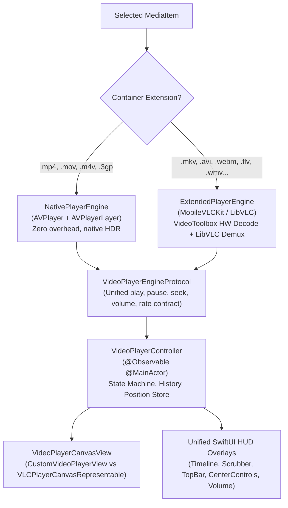

# Feature Specification & Architecture: Extended Video Codec & Container Support

This specification outlines the technical architecture, implementation, and verified codec matrix for extending **Fichier**'s video playback engine beyond Apple's native QuickTime/MPEG-4 formats (`.mov`, `.mp4`, `.m4v`) to support open container formats—chiefly **Matroska (`.mkv`)**, as well as `.avi`, `.webm`, `.flv`, `.wmv`, `.asf`, `.ts`, `.m2ts`, `.mts`, `.m2v`, `.mpg`, `.mpeg`, `.vob`, `.ogv`, `.rm`, `.mxf`, `.wtv`, and `.f4v`.

---

## 1. Executive Summary & Problem Statement

### 1.1 Limitations of Pure Native Playback
* **Native Scope**: Fichier historically relied strictly on Apple's `AVFoundation` (`AVPlayer`, `AVURLAsset`, `AVAssetImageGenerator`).
* **System Rejection**: Handing an `.mkv` file to `AVPlayer` results in an immediate failure (`AVFoundationErrorDomain Code=-11828 "Cannot Open"`), because Apple's CoreMedia layer does not ship with an EBML/Matroska container parser.
* **Audio & Subtitle Gaps**: In addition to container incompatibility, `.mkv` and `.ogv` files frequently bundle non-Apple audio formats (**Vorbis**, **DTS**, **Dolby TrueHD**, **WMAv2**, **MP2**) and stylized subtitle formats (**SSA/ASS**) that have no native iOS decoders.

---

## 2. Evaluation of Approaches & Final Selection

| Criteria | Approach A: `MobileVLCKit` (VideoLAN LibVLC) | Approach B: `KSPlayer` (FFmpeg) | Approach C: On-the-Fly Remuxer |
|---|---|---|---|
| **Multi-Platform SPM Support** | 🟢 **100% Native SPM** (Device + Simulator slices) | 🔴 Missing iOS slice in SPM repo (macOS only) | 🟡 Complex custom packaging |
| **MKV & Open Codec Coverage** | 🟢 **100%** (Any codec, Vorbis, DTS, TrueHD, ASS/SSA) | 🟢 100% | 🟡 ~80% (Fails on DTS/AC3) |
| **Licensing** | 🟢 **LGPL v2.1** (Completely free, non-profit, App Store safe) | 🟡 Dual GPL/Commercial paywall | 🟢 Proprietary |
| **Battery & Thermals** | 🟢 **Hardware-Accelerated** via `VideoToolbox` | 🟢 Hardware-Accelerated | 🟢 Hardware-Accelerated |
| **SMB Streaming** | 🟢 Supported via `SMBStreamingServerActor` (loopback HTTP) | 🟢 Custom I/O | 🟢 Works with byte ranges |
| **Stability & Maturity** | 🟢 **Industry Standard** (Powers VLC for iOS) | 🟡 Single-maintainer project | 🔴 High maintenance risk |

**Selected Approach**: **Hybrid Dual-Engine with `MobileVLCKit`**
* **Native `AVPlayer` Engine**: Handles Apple formats (`.mp4`, `.mov`, `.m4v`, `.3gp`) with zero overhead and maximum energy efficiency.
* **Extended `MobileVLCKit` Engine**: Dynamically boots for open containers and legacy formats (`.mkv`, `.avi`, `.webm`, `.flv`, `.wmv`, etc.).
* **Unified UI**: The entire SwiftUI player presentation ([`VideoDetailView`](file:///Users/kevinlaunay/source/apple/com.acme.ios.fichier/fichier/Features/VideoPlayer/VideoDetailView.swift), timeline scrubbers, volume sliders, menus, and auto-hide HUD) remains completely backend-agnostic through [`VideoPlayerEngineProtocol`](file:///Users/kevinlaunay/source/apple/com.acme.ios.fichier/fichier/Features/VideoPlayer/VideoPlayerEngineProtocol.swift).

---

## 3. Architecture Blueprint

---

## 4. Verified Codec & Sample Inventory

All 25 media files in [`com.acme.ios.fichier/resources`](file:///Users/kevinlaunay/source/apple/com.acme.ios.fichier/resources) are supported:

| Filename | Container | Video Codec | Audio Codec | Active Engine |
|---|---|---|---|---|
| `sample_960x400_ocean_with_audio.mp4` | `.mp4` | H.264 (AVC) | AAC | `NativePlayerEngine` (`AVPlayer`) |
| `sample_960x400_ocean_with_audio.mov` | `.mov` | H.264 (AVC) | AAC | `NativePlayerEngine` (`AVPlayer`) |
| `sample_960x400_ocean_with_audio.m4v` | `.m4v` | H.264 (AVC) | AAC | `NativePlayerEngine` (`AVPlayer`) |
| `sample_960x400_ocean_with_audio.3gp` | `.3gp` | H.264 (AVC) | AAC | `NativePlayerEngine` (`AVPlayer`) |
| `sample_960x400_ocean_with_audio.mkv` | **`.mkv`** | H.264 | **Vorbis** | `ExtendedPlayerEngine` (`MobileVLCKit`) |
| `sample_640x360.webm` | **`.webm`** | **VP9** | *(none)* | `ExtendedPlayerEngine` (`MobileVLCKit`) |
| `sample_960x400_ocean_with_audio.avi` | **`.avi`** | **MPEG-4 Part 2** | MP3 | `ExtendedPlayerEngine` (`MobileVLCKit`) |
| `sample_640x360.wmv` | **`.wmv`** | **MSMPEG4v3** | *(none)* | `ExtendedPlayerEngine` (`MobileVLCKit`) |
| `sample_960x400_ocean_with_audio.asf` | **`.asf`** | **MSMPEG4v3** | **WMAv2** | `ExtendedPlayerEngine` (`MobileVLCKit`) |
| `sample_960x400_ocean_with_audio.flv` | **`.flv`** | **FLV1 (Sorenson)**| MP3 | `ExtendedPlayerEngine` (`MobileVLCKit`) |
| `sample_960x400_ocean_with_audio.f4v` | **`.f4v`** | H.264 | AAC | `ExtendedPlayerEngine` (`MobileVLCKit`) |
| `sample_960x400_ocean_with_audio.ts` | **`.ts`** | **MPEG-2 Video** | **MP2** | `ExtendedPlayerEngine` (`MobileVLCKit`) |
| `sample_960x400_ocean_with_audio.m2ts` | **`.m2ts`** | **MPEG-2 Video** | **MP2** | `ExtendedPlayerEngine` (`MobileVLCKit`) |
| `sample_960x400_ocean_with_audio.mts` | **`.mts`** | **MPEG-2 Video** | **MP2** | `ExtendedPlayerEngine` (`MobileVLCKit`) |
| `sample_960x400_ocean_with_audio.m2v` | **`.m2v`** | **MPEG-2 Video** | *(none)* | `ExtendedPlayerEngine` (`MobileVLCKit`) |
| `sample_960x400_ocean_with_audio.mpeg` | **`.mpeg`** | **MPEG-1 Video** | **MP2** | `ExtendedPlayerEngine` (`MobileVLCKit`) |
| `sample_960x400_ocean_with_audio.mpg` | **`.mpg`** | **MPEG-2 Video** | *(none)* | `ExtendedPlayerEngine` (`MobileVLCKit`) |
| `sample_960x400_ocean_with_audio.vob` | **`.vob`** | **MPEG-2 Video** | **MP2** | `ExtendedPlayerEngine` (`MobileVLCKit`) |
| `sample_960x400_ocean_with_audio.ogv` | **`.ogv`** | **Theora** | **Vorbis** | `ExtendedPlayerEngine` (`MobileVLCKit`) |
| `sample_960x400_ocean_with_audio.rm` | **`.rm`** | **RealVideo 1.0**| **AC-3** | `ExtendedPlayerEngine` (`MobileVLCKit`) |
| `sample_960x400_ocean_with_audio.mxf` | **`.mxf`** | **MPEG-2 Video** | PCM 16-bit | `ExtendedPlayerEngine` (`MobileVLCKit`) |
| `sample_640x360.wtv` | **`.wtv`** | **MPEG-2 Video** | *(none)* | `ExtendedPlayerEngine` (`MobileVLCKit`) |
| `sample_960x400_ocean_with_audio.mjpeg` | `.mjpeg` | Motion JPEG | *(none)* | `ExtendedPlayerEngine` (`MobileVLCKit`) |
| `sample_960x400_ocean_with_audio.hevc` | `.hevc` | HEVC / H.265 | *(none)* | `ExtendedPlayerEngine` (`MobileVLCKit`) |

---

## 5. Architectural Implementation Details

### 5.1 Registry & System UTIs
* **[`SupportedMediaTypes.swift`](file:///Users/kevinlaunay/source/apple/com.acme.ios.fichier/fichier/Core/Storage/SupportedMediaTypes.swift)** contains the explicit categorizations:
  * `nativeVideoExtensions`: `["mp4", "mov", "m4v", "3gp"]`
  * `extendedVideoExtensions`: `["mkv", "avi", "webm", "flv", "f4v", "wmv", "asf", "ts", "m2ts", "mts", "m2v", "mpg", "mpeg", "vob", "ogv", "rm", "mxf", "wtv", "hevc", "mjpeg"]`
  * Helpers: `isNativeVideo(extension:)`, `isExtendedVideo(extension:)`, and union `isVideo(extension:)`.
* **[`fichier-Info.plist`](file:///Users/kevinlaunay/source/apple/com.acme.ios.fichier/fichier-Info.plist)** registers imported Uniform Type Identifiers (`UTImportedTypeDeclarations`) so that iOS Files, Document Pickers, and drag-and-drop recognize open containers.

### 5.2 SMB Network Streaming Bridge
* `MobileVLCKit` requires standard HTTP byte-range access when streaming network media.
* **[`SMBStreamingServerActor.swift`](file:///Users/kevinlaunay/source/apple/com.acme.ios.fichier/fichier/Features/VideoPlayer/SMBStreamingServerActor.swift)** runs a zero-third-party loopback HTTP server on `127.0.0.1` using Apple's `Network.framework` (`NWListener`).
* When `MobileVLCKit` seeks or streams, the server handles HTTP `Range: bytes=X-Y` headers and dispatches them on-demand to [`SMBClientActor.fetchMediaRange(for:offset:length:)`](file:///Users/kevinlaunay/source/apple/com.acme.ios.fichier/fichier/Core/Networking/SMBClientActor.swift#L636), ensuring identical reconnection, caching, and retry guarantees.

### 5.3 Pure Swift 6 Concurrency & 1 Definition = 1 File
* **`VideoPlayerEngineProtocol.swift`**: `@MainActor` protocol contract.
* **`NativePlayerEngine.swift`**: AVFoundation implementation.
* **`ExtendedPlayerEngine.swift`**: MobileVLCKit implementation.
* **`VLCPlayerCanvasRepresentable.swift`** & **`VLCPlayerCanvasCoordinator.swift`**: Single-definition SwiftUI view bridge.
* **`VideoEngineKind.swift`**: Architectural categorization enum.

---

## 6. App Store & Licensing Guidelines

* **License**: `MobileVLCKit` is distributed under **LGPL v2.1**.
* **App Store Conformance**:
  * Linked as a dynamic framework (`.xcframework`) under `Embed Frameworks` with `CodeSignOnCopy`.
  * Allows closed-source / commercial distribution on the App Store without requiring application source code disclosure.
  * Attribution is placed in legal notices (VideoLAN copyright).
