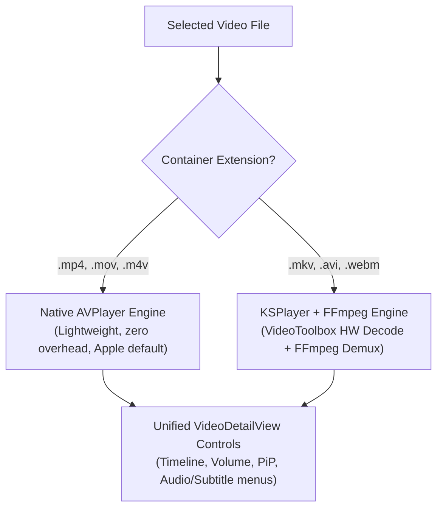

# Feature Specification: Extended Video Codec & Container Support (MKV, AVI, WebM)

This specification outlines the technical architecture, trade-offs, and step-by-step roadmap for extending **Fichier**'s video playback engine beyond Apple's native QuickTime/MPEG-4 formats (`.mov`, `.mp4`, `.m4v`) to support open container formats—chiefly **Matroska (`.mkv`)**, as well as `.avi`, `.webm`, and `.flv`.

---

## 1. Executive Summary & Problem Statement

### 1.1 Current Limitations
* **Native Scope**: Fichier currently relies strictly on Apple's `AVFoundation` (`AVPlayer`, `AVURLAsset`, `AVAssetImageGenerator`).
* **Format Restriction**: In [`SupportedMediaTypes.swift`](file:///Users/kevinlaunay/source/apple/com.acme.ios.fichier/fichier/Core/Storage/SupportedMediaTypes.swift#L17-L19), supported video extensions are restricted to:
  ```swift
  public static let videoExtensions: Set<String> = ["mp4", "mov", "m4v"]
  ```
* **System Rejection**: Handing an `.mkv` file to `AVPlayer` results in an immediate failure (`AVFoundationErrorDomain Code=-11828 "Cannot Open"`), because Apple's CoreMedia layer does not ship with an EBML/Matroska container parser.
* **Audio & Subtitle Gaps**: In addition to container incompatibility, `.mkv` files frequently bundle non-Apple audio formats (**DTS**, **Dolby TrueHD**, **Vorbis**) and stylized subtitle formats (**SSA/ASS**) that have no native iOS decoders.

---

## 2. Evaluation of Approaches

| Criteria | Approach A: `KSPlayer` (FFmpeg + VideoToolbox) | Approach B: On-the-Fly fMP4 Remuxer | Approach C: "Open in..." External Handoff |
|---|---|---|---|
| **MKV Compatibility** | 🟢 **100%** (Any codec, DTS, TrueHD, ASS/SSA) | 🟡 **~80%** (Fails on DTS/AC3 without transcoding) | 🟢 **100%** (External player handles all) |
| **App Size Overhead** | 🟡 **+25–35 MB** (FFmpeg C/C++ static/dynamic libs) | 🟢 **< 2 MB** | 🟢 **0 MB** |
| **Battery & Thermals** | 🟢 **Hardware-Accelerated** via `VideoToolbox` | 🟢 **Hardware-Accelerated** via `AVPlayer` | 🟢 Handled by external app |
| **Picture-in-Picture** | 🟢 Native `AVPictureInPictureController` supported | 🟢 Native `AVPlayer` PiP | 🔴 Leaves Fichier entirely |
| **SMB Streaming** | 🟢 Custom I/O protocol adapts to `SMBClientActor` | 🟢 Works with `SMBResourceLoaderDelegate` | 🔴 Requires local file download |
| **Implementation Effort** | 🟡 **Medium** (Standard SPM integration) | 🔴 **Very High** (Complex demux/remux engine) | 🟢 **Very Low** (Quick action button) |

---

## 3. Recommended Architectural Choice: Hybrid Dual-Engine via `KSPlayer`

The industry-standard solution adopted by modern iOS media apps (such as Infuse, Plex, and VLC) is a **hybrid playback architecture**:



### Why This Hybrid Design?
1. **Zero Regression for Standard Formats**: 90%+ of phone-captured videos (`.mov`, `.mp4`) continue using pure Apple `AVPlayer` with maximum energy efficiency and zero extra layer.
2. **Universal Compatibility for Network Videos**: When browsing network shares containing `.mkv` TV episodes or movies, the player seamlessly delegates to `KSPlayer`.
3. **Hardware Acceleration**: `KSPlayer` feeds H.264/HEVC frames straight into Apple's `VideoToolbox` silicon decoders—preventing CPU battery drain and device heating.

---

## 4. Implementation Blueprint & Roadmap

### Phase 1: Dependency Setup & Package Integration
1. **Swift Package Manager (SPM)**:
   Add [`KSPlayer`](https://github.com/kingslay/KSPlayer) to `fichier.xcodeproj` (or via SPM):
   - Package URL: `https://github.com/kingslay/KSPlayer.git`
   - Target product: `KSPlayer` (which bundles `FFmpegKit` prebuilt binaries with `VideoToolbox` hardware acceleration enabled).

### Phase 2: Media Type Declaration & Registry
1. **Update [`SupportedMediaTypes.swift`](file:///Users/kevinlaunay/source/apple/com.acme.ios.fichier/fichier/Core/Storage/SupportedMediaTypes.swift)**:
   ```swift
   public static let videoExtensions: Set<String> = [
       "mp4", "mov", "m4v", "mkv", "avi", "webm"
   ]
   ```
2. **Update Uniform Type Identifier (UTI) Detection**:
   Register custom exported/imported type identifiers in `Info.plist` for `org.matroska.mkv` (`public.matroska-video`) so the system recognizes `.mkv` files during document picker and drag-and-drop operations.

### Phase 3: SMB Streaming Bridge for Extended Formats
1. **Adapter for SMB Streaming**:
   `KSPlayer` supports custom URL protocols or custom asynchronous I/O callbacks (`KSPlayerResourceLoader`).
   Bridge `KSPlayer`'s chunk requests directly into `SMBClientActor.fetchMediaRange(for:offset:length:)`—reusing Fichier's existing socket auto-reconnection and exponential backoff architecture.

### Phase 4: Unified Player View Abstraction
1. Create a protocol `MediaPlayerControllable: AnyObject, Sendable`:
   - Properties: `currentTime`, `duration`, `isPlaying`, `isMuted`, `volume`, `playbackRate`.
   - Methods: `play()`, `pause()`, `seek(to:completion:)`, `selectAudioTrack(id:)`, `selectSubtitleTrack(id:)`.
2. Wrap `KSPlayerView` in a SwiftUI `UIViewRepresentable` matching `CustomVideoPlayerView.swift`.
3. Share the existing overlay HUD in [`VideoDetailView.swift`](file:///Users/kevinlaunay/source/apple/com.acme.ios.fichier/fichier/Features/VideoPlayer/VideoDetailView.swift) (`topBar`, `bottomControls`, `VideoTimelineBar`, gesture scrubber) across both backends.

### Phase 5: Video Thumbnail Extraction for MKVs
1. Implement an MKV thumbnail provider in `MediaCacheManager.swift`:
   - Use `KSPlayer`'s thumbnail extraction API or `AVAssetImageGenerator` fallback.
   - Sample keyframes at `MediaCacheManager.defaultVideoThumbnailTime` (`12.0s`) with fallback to `0.5s`.
   - Store the generated thumbnails into Fichier's existing Tier 2 JPEG disk cache (`saveThumbnailAsync`).

---

## 5. Licensing, App Store & Binary Size Guidelines

* **App Store Guidelines**: Using FFmpeg within an iOS app is fully permitted by Apple, provided no private APIs are touched.
* **Licensing (LGPL v2.1)**:
  - Standard FFmpeg builds used by `KSPlayer` are distributed under the **LGPL v2.1** license.
  - Link FFmpeg as a **dynamic framework** (`.xcframework`) rather than a static binary, allowing users/auditors to replace the dynamic library if required by LGPL compliance.
  - Avoid enabling non-free or GPL-only codecs (e.g., `x264`, `x265` software encoders) in the FFmpeg build configuration; rely on Apple's built-in `VideoToolbox` decoders instead.
* **Binary Size Footprint**:
  - The precompiled binary framework adds approximately $\sim 28\,\text{MB}$ to the uncompressed `.ipa` download.

---

## 6. Summary Checklist for Future Implementation

- [ ] Add `KSPlayer` SPM package dependency.
- [ ] Add `"mkv"`, `"avi"`, `"webm"` to `SupportedMediaTypes.videoExtensions`.
- [ ] Implement `KSPlayer` SMB byte-range custom loader bridge to `SMBClientActor`.
- [ ] Bind `KSPlayer` track manager to Fichier's audio and subtitle menus.
- [ ] Implement MKV keyframe thumbnail extraction in `MediaCacheManager`.
- [ ] Verify background Picture-in-Picture (`AVPictureInPictureController`) on iOS 17+.
