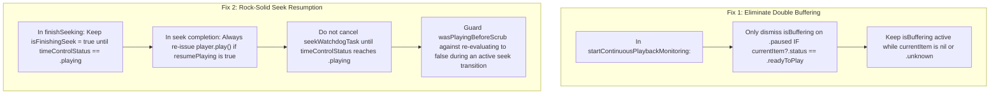

# Video Player Diagnostic & Investigation Report

**Date**: November 3, 2026  
**Target Component**: [`VideoDetailView.swift`](fichier/Features/VideoPlayer/VideoDetailView.swift)  
**Associated Modules**: [`VideoTimelineBar.swift`](fichier/Features/VideoPlayer/VideoTimelineBar.swift), [`SMBResourceLoaderDelegate.swift`](fichier/Features/VideoPlayer/SMBResourceLoaderDelegate.swift)  

---

## Executive Summary

An in-depth investigation was conducted into the two reported playback regressions in `VideoDetailView`:
1. **Double Display of the Buffering Popup**: When launching a video or switching to the next video (`goToNext`), the buffering popup displays twice in quick succession.
2. **Playing Video Pauses After Seeking**: When scrubbing the timeline or swiping the screen while playing, the video occasionally remains stuck in the paused state instead of resuming playback.

Both issues stem from state machine synchronization discrepancies between SwiftUI's `@State` tracking variables (`isBuffering`, `isPlaying`, `isFinishingSeek`), `AVPlayer.timeControlStatus`, and the asynchronous chunk-loading pipeline of `AVURLAsset` over SMB.

---

## 1. Problem 1: Double Display of Buffering Popup

### Symptoms
When opening any video from the gallery or tapping "Next Video" / "Previous Video", the buffering indicator appears, disappears for a fraction of a second, reappears, and then finally disappears when video frames begin rendering.

### Root Cause Analysis

The double display is caused by an unintended state transition inside `startContinuousPlaybackMonitoring`:

```
┌─────────────────────────────────────────────────────────────────────────────┐
│ 1. setupPlayer called                                                       │
│    isBuffering = true                                                       │
│    --> Popup appears (Display #1)                                           │
└──────────────────────────────────────┬──────────────────────────────────────┘
                                       │
                                       ▼
┌─────────────────────────────────────────────────────────────────────────────┐
│ 2. AVPlayer initialized with AVPlayerItem(asset:)                           │
│    AVPlayerItem status is .unknown (reading movie header / moov over SMB)   │
│    avPlayer.timeControlStatus is initially .paused                         │
└──────────────────────────────────────┬──────────────────────────────────────┘
                                       │
                                       ▼
┌─────────────────────────────────────────────────────────────────────────────┐
│ 3. startContinuousPlaybackMonitoring polls (120ms tick)                     │
│    Evaluates switch p.timeControlStatus:                                    │
│    case .paused:                                                            │
│        self.isBuffering = false  <-- Prematurely hides buffering!           │
│    --> Popup vanishes                                                       │
└──────────────────────────────────────┬──────────────────────────────────────┘
                                       │
                                       ▼
┌─────────────────────────────────────────────────────────────────────────────┐
│ 4. Header bytes arrive; item status transitions to .readyToPlay             │
│    avPlayer transitions to .waitingToPlayAtSpecifiedRate (filling buffer)   │
│    After 850ms of grace time:                                               │
│    case .waitingToPlayAtSpecifiedRate:                                      │
│        self.isBuffering = true   <-- Turns buffering back on!               │
│    --> Popup reappears (Display #2)                                         │
└──────────────────────────────────────┬──────────────────────────────────────┘
                                       │
                                       ▼
┌─────────────────────────────────────────────────────────────────────────────┐
│ 5. Sufficient audio/video frames decoded                                    │
│    p.timeControlStatus reaches .playing                                     │
│    self.isBuffering = false                                                 │
│    --> Popup permanently vanishes                                           │
└─────────────────────────────────────────────────────────────────────────────┘
```

### Exact Code Flaw

In `VideoDetailView.swift` (lines 1411–1416):
```swift
case .paused:
    waitingStartTime = nil
    if self.isBuffering {
        withAnimation(.easeInOut(duration: 0.2)) {
            self.isBuffering = false // ⚠️ BUG: Dismisses buffering even when the asset is still in .unknown initial loading state
        }
    }
```
During initial setup, `avPlayer.timeControlStatus` is `.paused` because `currentItem?.status` is `.unknown`. The monitor misinterpreted this initial engine state as a user-initiated pause, dismissed `isBuffering`, and then re-enabled it 850ms later when `timeControlStatus` became `.waitingToPlayAtSpecifiedRate`.

---

## 2. Problem 2: Playing Video Pausing After Seeking

### Symptoms
When a playing video is scrubbed via the bottom timeline bar or screen swipe gesture, it occasionally lands in the paused state with the center play icon displayed, requiring the user to manually tap "Play".

### Root Cause Analysis

Three interacting race conditions contribute to this behavior:

### A. Premature Release of `isFinishingSeek`
In `VideoDetailView.swift` (lines 1016–1028):
```swift
player.seek(to: targetCM, toleranceBefore: tolerance, toleranceAfter: tolerance) { _ in
    Task { @MainActor in
        guard thisGeneration == self.seekGeneration else { return }
        self.seekWatchdogTask?.cancel()
        self.seekWatchdogTask = nil
        self.isFinishingSeek = false // ⚠️ Prematurely cleared before playback actually starts
        
        if resumePlaying {
            if player.timeControlStatus == .paused {
                player.play()
            }
            self.isPlaying = true
        }
        ...
    }
}
```

1. **AVPlayer Seek Mechanics**: `player.seek` fires its completion block when the target time is set on the timebase. It does **not** wait for media samples to be loaded from the network.
2. When the callback fires over an SMB share, `player.timeControlStatus` is usually `.waitingToPlayAtSpecifiedRate` (waiting for network buffers).
3. Because `timeControlStatus` is not `.paused`, line 1024 does not call `player.play()`.
4. Crucially, `isFinishingSeek` is set to `false`, and the 2.5s watchdog task is cancelled.
5. In the next 120ms tick of `startContinuousPlaybackMonitoring` or the 500ms tick of `periodicTimeObserver`:
   - If AVPlayer encounters an empty buffer and its internal state drops to `.paused` (rate = 0):
   ```swift
   if self.isPlaying && !self.isScrubbingTimeline && !self.isScrubbingWithGesture && !self.isFinishingSeek {
       self.isPlaying = false // ⚠️ Sets isPlaying to false because isFinishingSeek was already false
   }
   ```
   - `isPlaying` is clobbered to `false`, and the player never resumes.

### B. `wasPlayingBeforeScrub` Capture Corruption on Rapid Taps
In `VideoDetailView.swift` (lines 773–782 and 809–813):
```swift
wasPlayingBeforeScrub = (player?.timeControlStatus != .paused) || isPlaying
if wasPlayingBeforeScrub {
    player?.pause()
    isPlaying = false
}
```
When scrubbing starts, `player.pause()` is called immediately to preserve network socket bandwidth. If the user touches or taps the timeline bar in rapid succession (or if gesture handlers re-fire before playback resumes):
- `player` is already paused from the previous touch.
- `wasPlayingBeforeScrub` is evaluated as `false`.
- When the gesture ends, `finishSeeking(..., resumePlaying: false)` is executed.
- The player deliberately stays paused.

### C. Watchdog Cancellation Before Playback Confirmation
The watchdog task (`seekWatchdogTask`) was created specifically as a fail-safe to guarantee resumption if AVPlayer stalled during seek. However, the seek completion handler cancelled the watchdog before confirming that `timeControlStatus == .playing`. Once cancelled, there was no safety net to kick-start playback if AVPlayer stalled while waiting for byte ranges.

---

## 3. Targeted Remediation Plan



### Applied Code Modifications

1. **Fix `isBuffering` in `startContinuousPlaybackMonitoring`**:
   Only clear `isBuffering` in `case .paused:` if the playerItem has reached `.readyToPlay`. During initial loading (`.unknown` or `nil`), preserve `isBuffering = true` so the buffering popup appears exactly once and transitions smoothly into playback.

2. **Fix Seek Resumption in `finishSeeking` and Observers**:
   - Keep `isFinishingSeek = true` until `p.timeControlStatus == .playing` (or watchdog timeout), preventing `isPlaying` from being prematurely set to `false`.
   - Keep `seekWatchdogTask` active until `timeControlStatus` confirms `.playing`.
   - In `finishSeeking` seek completion, always re-issue `player.play()` when `resumePlaying == true` unconditionally.
   - When `p.timeControlStatus == .playing` in `startContinuousPlaybackMonitoring`, release `isFinishingSeek = false` and cancel `seekWatchdogTask`.
   - In timeline and swipe gesture handlers, protect `wasPlayingBeforeScrub` from being overwritten as `false` when a seek is already in flight (`isFinishingSeek == true`).
