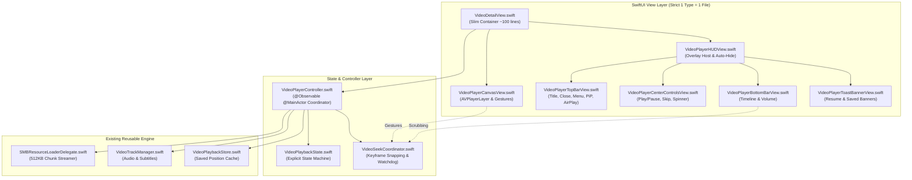

# Implementation Plan: Video Player 2.0 Rebuild

Rebuild the video player module from scratch into a decoupled, state-machine-driven architecture. This refactoring decomposes the monolithic 1,540-line [`VideoDetailView.swift`](file:///Users/kevinlaunay/source/apple/com.acme.ios.fichier/fichier/Features/VideoPlayer/VideoDetailView.swift) into an `@Observable` playback controller, a dedicated seek coordinator, an explicit playback state machine, and modular single-responsibility views—strictly adhering to **Pure Swift 6 Concurrency** and the **Strict 1 Definition = 1 File** workspace rule.

---

## 1. User Review Required

> [!IMPORTANT]
> **No External API or Interface Breaking Changes**:
> The public interface `VideoDetailView(manager: StorageLocationManager, videos: [MediaItem], initialItem: MediaItem)` is preserved 100%. Presentation callers (such as `RootSMBView` and gallery views) require zero modifications.

> [!NOTE]
> **Swift 6 & Strict 1 Definition = 1 File**:
> Every new class, struct, actor, and enum resides in its own dedicated `.swift` file under `fichier/Features/VideoPlayer/`. Xcode 16's `PBXFileSystemSynchronizedRootGroup` automatically tracks and compiles all newly created files in this directory.

---

## 2. Architecture Comparison

### Current Monolithic Architecture (1,540 lines)
```
VideoDetailView.swift (God View)
├── 25+ independent @State variables
├── Direct AVPlayer / AVPlayerItem lifecycle management
├── SMB 512KB chunk streaming coordination
├── Generational seek state machine & stationary frame debounce
├── Continuous timeControlStatus polling loop & periodic time observer
├── Gesture handling (Horizontal swipe, 2-finger tap, single tap)
├── Top bar, center controls, bottom timeline, volume slider, toasts
└── Video switching & position restoration logic
```

### Proposed Modular Architecture


---

## 3. Proposed Changes & Specifications

### Component 1: State Machine & Controller Layer

#### [NEW] `VideoPlaybackState.swift`
- **Path**: [`fichier/Features/VideoPlayer/VideoPlaybackState.swift`](file:///Users/kevinlaunay/source/apple/com.acme.ios.fichier/fichier/Features/VideoPlayer/VideoPlaybackState.swift)
- **Purpose**: Defines explicit playback states, replacing 6 conflicting boolean flags (`isBuffering`, `isPlaying`, `isFinishingSeek`, `isSeekingFrame`, `isScrubbingTimeline`, `isScrubbingWithGesture`).
```swift
public enum VideoPlaybackState: Equatable, Sendable {
    case idle
    case loading(MediaItem)
    case buffering
    case playing
    case paused
    case failed(String)
    
    public var isPlaying: Bool {
        if case .playing = self { return true }
        return false
    }
    
    public var isBuffering: Bool {
        switch self {
        case .loading, .buffering: return true
        default: return false
        }
    }
}
```

---

#### [NEW] `VideoSeekCoordinator.swift`
- **Path**: [`fichier/Features/VideoPlayer/VideoSeekCoordinator.swift`](file:///Users/kevinlaunay/source/apple/com.acme.ios.fichier/fichier/Features/VideoPlayer/VideoSeekCoordinator.swift)
- **Purpose**: Encapsulates the entire seeking pipeline:
  - Generational seek invalidation (`seekGeneration += 1`)
  - Adaptive live seek tolerance ($0.5\text{s} - 1.5\text{s}$ snap to keyframes)
  - 100ms throttle gate & 250ms stationary exact-frame debounce
  - 1.0s keyframe snapping on final commit
  - 2.5s fail-safe watchdog timer
  - Re-entrancy protection lock (`isFinishingSeek`) that only clears when `timeControlStatus == .playing`

---

#### [NEW] `VideoPlayerController.swift`
- **Path**: [`fichier/Features/VideoPlayer/VideoPlayerController.swift`](file:///Users/kevinlaunay/source/apple/com.acme.ios.fichier/fichier/Features/VideoPlayer/VideoPlayerController.swift)
- **Purpose**: `@Observable @MainActor` class managing the AVFoundation engine:
  - Owns `AVPlayer`, `AVPlayerItem`, and `currentAsset`
  - Instantiates `SMBResourceLoaderDelegate` with 512KB chunks for SMB streams
  - Manages `AVAudioSession` category configuration asynchronously
  - Coordinates `VideoSeekCoordinator` and `VideoTrackManager`
  - Observes `AVPlayer.timeControlStatus` and drives `VideoPlaybackState`
  - Handles periodic time observing (updating `currentPlaybackSeconds` and auto-saving to `VideoPlaybackStore`)
  - Provides playlist navigation methods: `loadItem(_:)`, `goToNext()`, `goToPrevious()`

---

### Component 2: Modular UI Layer (Strict 1 Definition = 1 File)

#### [NEW] `VideoPlayerCanvasView.swift`
- **Path**: [`fichier/Features/VideoPlayer/VideoPlayerCanvasView.swift`](file:///Users/kevinlaunay/source/apple/com.acme.ios.fichier/fichier/Features/VideoPlayer/VideoPlayerCanvasView.swift)
- **Purpose**: Hosts `CustomVideoPlayerView` (`AVPlayerLayer`), manages PiP delegate callback, and attaches the horizontal swipe-to-seek and two-finger tap play/pause gestures.

---

#### [NEW] `VideoPlayerTopBarView.swift`
- **Path**: [`fichier/Features/VideoPlayer/VideoPlayerTopBarView.swift`](file:///Users/kevinlaunay/source/apple/com.acme.ios.fichier/fichier/Features/VideoPlayer/VideoPlayerTopBarView.swift)
- **Purpose**: Top bar overlay with close button, filename, item counter & size, PiP toggle, AirPlay button (`AirPlayButtonView`), and the playback options menu (subtitles, audio track, playback speed, restart, save to camera roll, native `ShareLink`).

---

#### [NEW] `VideoPlayerCenterControlsView.swift`
- **Path**: [`fichier/Features/VideoPlayer/VideoPlayerCenterControlsView.swift`](file:///Users/kevinlaunay/source/apple/com.acme.ios.fichier/fichier/Features/VideoPlayer/VideoPlayerCenterControlsView.swift)
- **Purpose**: Renders the centered buffering spinner (when `controller.playbackState.isBuffering`), large play/pause button (when not buffering), and previous/next skip buttons.

---

#### [NEW] `VideoPlayerBottomBarView.swift`
- **Path**: [`fichier/Features/VideoPlayer/VideoPlayerBottomBarView.swift`](file:///Users/kevinlaunay/source/apple/com.acme.ios.fichier/fichier/Features/VideoPlayer/VideoPlayerBottomBarView.swift)
- **Purpose**: Renders `VideoTimelineBar` connected to `controller.seekCoordinator` and `VideoVolumeBar` connected to `controller`.

---

#### [NEW] `VideoPlayerToastBannerView.swift`
- **Path**: [`fichier/Features/VideoPlayer/VideoPlayerToastBannerView.swift`](file:///Users/kevinlaunay/source/apple/com.acme.ios.fichier/fichier/Features/VideoPlayer/VideoPlayerToastBannerView.swift)
- **Purpose**: Reusable glassmorphic toast pill for "Resumed from XX:XX" and "Saved to Photos".

---

#### [NEW] `VideoPlayerHUDView.swift`
- **Path**: [`fichier/Features/VideoPlayer/VideoPlayerHUDView.swift`](file:///Users/kevinlaunay/source/apple/com.acme.ios.fichier/fichier/Features/VideoPlayer/VideoPlayerHUDView.swift)
- **Purpose**: Combines top bar, center controls, bottom controls, and toast notifications into an auto-hiding overlay (with 3.5s inactivity timer).

---

#### [MODIFY] `VideoDetailView.swift`
- **Path**: [`fichier/Features/VideoPlayer/VideoDetailView.swift`](file:///Users/kevinlaunay/source/apple/com.acme.ios.fichier/fichier/Features/VideoPlayer/VideoDetailView.swift)
- **Purpose**: Refactored into a concise host view (~100 lines):
  - Instantiates `VideoPlayerController`
  - Binds keyboard navigation shortcuts (arrow keys for seeking, space for play/pause, M for mute)
  - Mounts `VideoPlayerCanvasView` and `VideoPlayerHUDView`
  - Handles dismissal and background phase transitions

---

## 4. Verification Plan

### Automated Verification
1. Run full Swift syntax and parse verification across the entire project:
```bash
cd com.acme.ios.fichier && xcrun swiftc -parse -swift-version 6 -module-cache-path /tmp/ModuleCache -target arm64-apple-ios18.0-simulator -sdk $(xcrun --sdk iphonesimulator --show-sdk-path) $(find fichier -name "*.swift")
```
2. Typecheck with Swift 6 strict concurrency checks enabled.

### Manual Verification
1. **Initial Launch**: Open a video from an SMB share; verify the buffering popup appears exactly once and transitions cleanly into playback.
2. **Fast Playlist Switching**: Tap "Next" and "Previous" repeatedly; verify zero double-display of buffering popups.
3. **Timeline Scrubbing**: Drag the scrubber knob; verify smooth live frame feedback, keyframe snapping on release, and 100% reliable playback resumption.
4. **Swipe Seeking**: Perform horizontal swipes across the screen; verify adaptive duration sensitivity and instant resumption.
5. **Playback Options**: Verify subtitle selection, audio track switching, variable speed playback (0.5x - 2.0x), AirPlay casting, PiP, and Camera Roll export.
6. **Backgrounding & Position Restoration**: Background the app while playing; reopen and verify playback resumes from the saved timestamp.
