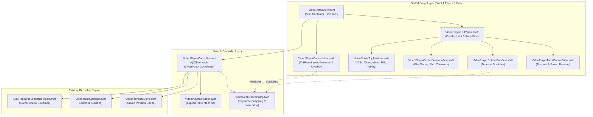

# Architecture & Refactor Plan: Video Player 2.0

Comprehensive design and implementation plan for rebuilding the video player module from scratch into a decoupled, state-machine-driven architecture. This refactor decomposes the monolithic 1,540-line `VideoDetailView.swift` into an `@Observable` playback controller, a dedicated seek coordinator, an explicit playback state machine, and modular single-responsibility views—strictly adhering to **Pure Swift 6 Concurrency** and the **1 Definition = 1 File** rule.

---

## 1. Architectural Goals & Invariants

1. **Strict 1 Definition = 1 File**: Every Swift struct, class, actor, and enum resides in its own dedicated `.swift` file under `fichier/Features/VideoPlayer/`.
2. **Pure Swift 6 Concurrency**: Full adherence to modern concurrency (`@Observable`, `@MainActor`, `Sendable`, structured tasks). Zero legacy locks (`NSLock`) or legacy Grand Central Dispatch primitives (`DispatchQueue.sync/async`).
3. **No External Breaking Changes**: Public interface `VideoDetailView(manager: SMBDirectManager, videos: [MediaItem], initialItem: MediaItem)` is 100% preserved. Callers (such as `RootSMBView`) require zero modifications.
4. **Single Source of Truth for Playback State**: Elimination of disjoint, conflicting boolean flags (`isBuffering`, `isPlaying`, `isFinishingSeek`, `isSeekingFrame`, `isScrubbingTimeline`, `isScrubbingWithGesture`). Explicit state enum `VideoPlaybackState`.
5. **Zero Double Buffering Popups**: Initial load, seek completion, and continuous status monitoring coordinate through state transitions, preventing duplicate or flickering HUD spinners.
6. **Robust Seek Resumption**: Keyframe tolerance (1.0s) on playback resume, re-entrancy lock (`isFinishingSeek`), and 2.5s fail-safe watchdog timer guarantee playback never stalls in a paused state after seeking over SMB network shares.

---

## 2. Architecture Comparison

### Previous Monolithic Architecture (1,540 lines)
```
VideoDetailView.swift (God View)
├── 25+ independent @State variables
├── Direct AVPlayer / AVPlayerItem lifecycle management
├── SMB 512KB chunk streaming coordination
├── Generational seek state machine & stationary frame debounce
├── Continuous timeControlStatus polling loop & periodic time observer
├── Gesture handling (Horizontal swipe, 2-finger tap, single tap)
├── Top bar, center controls, bottom timeline, volume slider, toasts
└── Video switching & position restoration logic
```

### Modular 2.0 Architecture


---

## 3. Component Breakdown

### Component 1: State Machine & Controller Layer

#### `VideoPlaybackState.swift`
- Path: `fichier/Features/VideoPlayer/VideoPlaybackState.swift`
- **Definition**:
```swift
public enum VideoPlaybackState: Equatable, Sendable {
    case idle
    case loading(MediaItem)
    case buffering
    case playing
    case paused
    case failed(String)
    
    public var isPlaying: Bool {
        if case .playing = self { return true }
        return false
    }
    
    public var isBuffering: Bool {
        switch self {
        case .loading, .buffering: return true
        default: return false
        }
    }
    
    public var errorMessage: String? {
        if case .failed(let msg) = self { return msg }
        return nil
    }
}
```

#### `VideoSeekCoordinator.swift`
- Path: `fichier/Features/VideoPlayer/VideoSeekCoordinator.swift`
- **Responsibilities**:
  - Generational seek invalidation (`seekGeneration += 1`).
  - 100ms throttle pacing & 250ms stationary zero-tolerance frame debounce.
  - Adaptive live seek tolerance (0.5s - 1.5s snap to keyframes during motion).
  - 1.0s keyframe snapping on final release/commit to avoid decoding dozens of P/B frames over SMB.
  - `isFinishingSeek` re-entrancy lock protecting `isPlaying = true` until `timeControlStatus == .playing`.
  - 2.5s fail-safe watchdog timer ensuring `player.play()` is enforced if playback stalls.

#### `VideoPlayerController.swift`
- Path: `fichier/Features/VideoPlayer/VideoPlayerController.swift`
- **Responsibilities**:
  - `@Observable @MainActor` manager owning `AVPlayer`, `AVPlayerItem`, and `AVURLAsset`.
  - Instantiates `SMBResourceLoaderDelegate` with 512KB chunks for high-throughput SMB streaming.
  - Coordinates `AVAudioSession` category configuration asynchronously off the main runloop.
  - Manages `VideoSeekCoordinator` and `VideoTrackManager` (subtitles, audio tracks, playback speed).
  - Drives `VideoPlaybackState` from `timeControlStatus` and error notifications.
  - Periodic time observation (updating `currentPlaybackSeconds` and auto-persisting to `VideoPlaybackStore`).
  - Playlist management (`goToNext()`, `goToPrevious()`, `playNextVideo()`).
  - Auto-hide controls timer (3.5s inactivity timeout).

---

### Component 2: Modular UI Layer (Strict 1 Definition = 1 File)

#### `VideoPlayerCanvasView.swift`
- Path: `fichier/Features/VideoPlayer/VideoPlayerCanvasView.swift`
- **Responsibilities**:
  - Hosts `CustomVideoPlayerView` (`AVPlayerLayer`).
  - Manages PiP status delegation and two-finger tap play/pause handling.
  - Displays buffering spinner, terminal error messages, and active subtitle text overlay.

#### `VideoPlayerTopBarView.swift`
- Path: `fichier/Features/VideoPlayer/VideoPlayerTopBarView.swift`
- **Responsibilities**:
  - Close button, filename/size capsule, `VideoVolumeBar`.
  - Action tools: Favorite button, Save to Camera Roll button (with spinner), native `ShareLink`, `AirPlayButtonView`.
  - Playback options menu (Subtitles, Audio tracks, Playback speed, PiP toggle).
  - Responsive layout: two-tier stacked layout on Compact Portrait vs single-row centered overlay on Regular/Landscape.

#### `VideoPlayerCenterControlsView.swift`
- Path: `fichier/Features/VideoPlayer/VideoPlayerCenterControlsView.swift`
- **Responsibilities**:
  - Central play/pause toggle button (shown when not buffering and error-free).
  - Side navigation chevrons for next/previous video navigation when playlist has $> 1$ video.

#### `VideoPlayerBottomBarView.swift`
- Path: `fichier/Features/VideoPlayer/VideoPlayerBottomBarView.swift`
- **Responsibilities**:
  - Hosts `VideoTimelineBar` connected to `controller.seekCoordinator`.

#### `VideoPlayerToastBannerView.swift`
- Path: `fichier/Features/VideoPlayer/VideoPlayerToastBannerView.swift`
- **Responsibilities**:
  - Reusable glassmorphic capsule view for "Resumed from XX:XX" (with "Restart" action button) and "Saved to Photos".

#### `VideoPlayerHUDView.swift`
- Path: `fichier/Features/VideoPlayer/VideoPlayerHUDView.swift`
- **Responsibilities**:
  - Combines top bar, center controls, bottom bar, and toast banners into an auto-hiding overlay (`controller.showControls`).

#### `VideoDetailView.swift`
- Path: `fichier/Features/VideoPlayer/VideoDetailView.swift`
- **Responsibilities**:
  - Concise container view (~130 lines).
  - Instantiates `VideoPlayerController`.
  - Binds swipe-to-seek gesture, tap-to-toggle-controls gesture, and hardware keyboard shortcuts.
  - Handles dismissal, notifications, and background scenePhase transitions.

---

## 4. Verification Plan

### Automated Verification
```bash
# Syntax and parse check across all files
cd com.acme.ios.fichier && xcrun swiftc -parse $(find fichier -name "*.swift")
```

### Manual Verification Matrix
1. **Initial Launch**: Open a video from an SMB share; verify the buffering popup appears exactly once and transitions cleanly into playback.
2. **Fast Playlist Switching**: Tap "Next" and "Previous" repeatedly; verify zero double-display of buffering popups.
3. **Timeline Scrubbing**: Drag the scrubber knob; verify smooth live frame feedback, keyframe snapping on release, and 100% reliable playback resumption.
4. **Swipe Seeking**: Perform horizontal swipes across the screen; verify adaptive duration sensitivity and instant resumption.
5. **Playback Options**: Verify subtitle selection, audio track switching, variable speed playback (0.5x - 2.0x), AirPlay casting, PiP, and Camera Roll export.
6. **Backgrounding & Position Restoration**: Background the app while playing; reopen and verify playback resumes from the saved timestamp.
